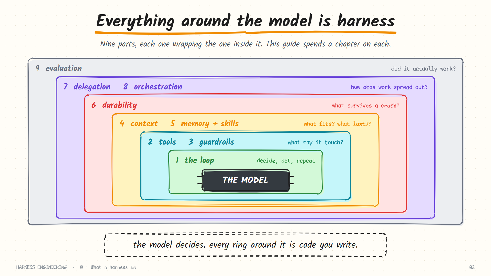

# ZILL Materials

**Lecture notes, diagrams, build prompts and source code for building a coding-agent harness from scratch.**

Zill is a small agent harness written in plain Python (standard library only). Over six lectures it grows from a 65-line loop into a full harness with tools, a permission gate, context compaction, memory, durable sessions, sub-agents, a fleet runner and a command-line client. These materials contain everything: the notes, every picture, the prompts, and the finished code.

**Read it as a site:** [akbarsheikh-debug.github.io/ZILL-Materials](https://akbarsheikh-debug.github.io/ZILL-Materials/)



## The six lectures

| # | Lecture | What it covers |
|---|---------|----------------|
| 1 | [The vocabulary: model, harness, loop and graph](lectures/lecture-1.md) | Prompt, context, harness, loop and graph engineering; what a model cannot do alone. |
| 2 | [The loop](lectures/lecture-2.md) | The heartbeat of every agent: the loop inside the harness, built as Zill's first component. |
| 3 | [Tools and security](lectures/lecture-3.md) | Giving the agent hands (tools, backends) and a conscience (permission gate, sandbox). |
| 4 | [Context and compaction](lectures/lecture-4.md) | What goes into the context window, how it fills up, and the compaction fold that keeps it under budget. |
| 5 | [Memory, sub-agents and durability](lectures/lecture-5.md) | Long-term memory, skills, resumable sessions and sub-agents. |
| 6 | [Harness, fleet and client](lectures/lecture-6.md) | Wiring everything into one class, running a fleet of agents, and the command-line front door. |

Lecture 5 also has a shorter [60-minute cut](lectures/lecture-5-short.md).

## All six in one file

[`resources/Lecture-1-to-Lecture-6.md`](resources/Lecture-1-to-Lecture-6.md) holds every lecture back to back, with all pictures and the build prompts at the end.

## What is in this repository

| Folder | Contents |
|---|---|
| [`lectures/`](lectures/) | One notes page per lecture, with the pictures in place |
| [`resources/`](resources/) | The combined Lecture 1 to 6 file, and the MIT license |
| [`prompts/`](prompts/) | The build prompt given to the coding agent at the end of each lecture |
| [`assets/`](assets/) | All 281 images, grouped by lecture |
| [`code/zill-harness/`](code/zill-harness/) | The finished Zill package, demos and tests |
| [`code/zill-demos/`](code/zill-demos/) | Small web pages the agent builds in the demos |
| [`code/mini-harness/`](code/mini-harness/) | A single-file runnable mini harness |
| [`code/tools/`](code/tools/) | Scripts that render the diagram sheets to PNG |
| [`sources/`](sources/) | The HTML sheets the diagrams were rendered from |
| [`archive/`](archive/) | Earlier drafts of some lecture scripts |

## Run Zill

```bash
cd code/zill-harness
export ZILL_API_KEY="your-key"      # PowerShell: $env:ZILL_API_KEY = "your-key"
python -m pytest tests               # the tests use fake models, no key needed
python demos/day1_dice.py            # needs a provider configured in zill/provider.py
```

Zill reads its key from the `ZILL_API_KEY` environment variable and never prints it. Set the provider and model in `zill/provider.py`.

## License

[MIT](LICENSE). Use it, change it, teach with it.
