# Lecture 3 — Tools and security

> **Two questions:** how does an agent get hands, and how do we stop those hands doing damage?
>
> Tools are the hands. Security is the conscience.

At the end of lecture 2, Zill was asked to "build a landing page for a coffee shop" and could only *describe* one. It had a brain and no hands. Today it gets both hands (**tools**) and a conscience (**security**).

## Where we left off

The loop from lecture 2 is complete, but it has two empty **sockets**:

| Socket | Last lecture | Filled today by |
|--------|-------------|-----------------|
| The list of tools | One toy dice roller | `tools.py` (the hands) and `operations.py` (where they work) |
| `before_tool`, a function the loop asks "may I run this?" before every tool | Said yes to everything | `security.py` (the conscience) |

The loop does not know the names of the tools; it only knows "here is a list of tools". That is why **`loop.py` does not change today, not one line.** Today is about plugging things into it.

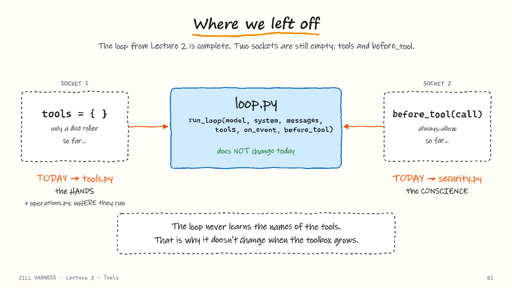
***Where we left off.** The loop from Lecture 2 is complete. Two sockets are still empty: tools and before_tool.*

---

# Part 1. What is a tool?

## Tools are the wheels

The model is the engine of a car; an engine alone takes you nowhere. Or picture a brain in a glass jar: it thinks well but cannot touch anything. A tool breaks the glass, letting the model reach your repository, terminal, Drive, Slack, or any API such as Zoom, Jira or Notion.

In the loop's vocabulary (thought, action, observation), the tool is the **action**.

> **A tool is anything that lets the model touch the outside world.**

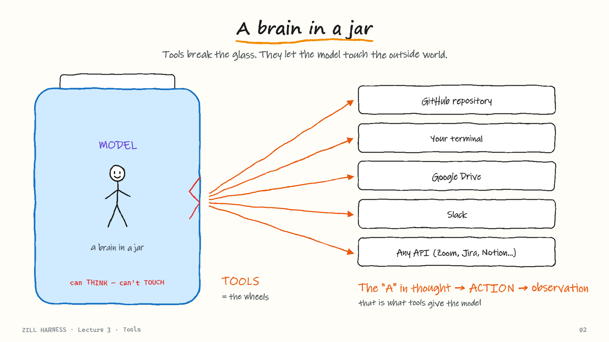
***A brain in a jar.** Tools break the glass. They let the model touch the outside world.*

## Two kinds of tools

| | Pre-built | External |
|---|---|---|
| Comes from | The harness itself | Added later by you or your project |
| Examples | `read`, `write`, `edit`, `bash`, `grep`, `ls`, `find` | MCP servers (a ready-made pack, such as a GitHub server), or your own registered script |

Two notes on the pre-built set. **bash** is the most powerful and the most dangerous, because it runs *any* command, including deletes; the whole second half of this lecture exists because of it. And **find** looks for a file by *name* while **grep** looks *inside* files for text.

How many tools to ship is a design decision. Pi ships very few and lets you add the rest, which keeps the code small. Hermes ships many, which is convenient but makes the code much bigger. **Zill follows Pi: few tools, small code.**

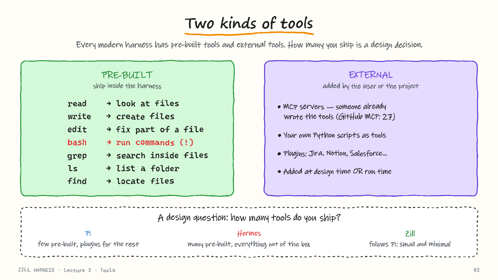
***Two kinds of tools.** Every modern harness has pre-built tools and external tools. How many you ship is a design decision.*

## The tool contract

This is the most important idea of the lecture.

> **The model never sees your code.** It chooses a tool by reading *words* only.

Think of a job posting on a notice board: a title, a description and a form to fill in. An applicant reads it and decides whether to apply, and never sees the real work, which happens behind a curtain. The model is the applicant; your code is behind the curtain. A vague posting brings wrong applications; a clear one brings the right ones.

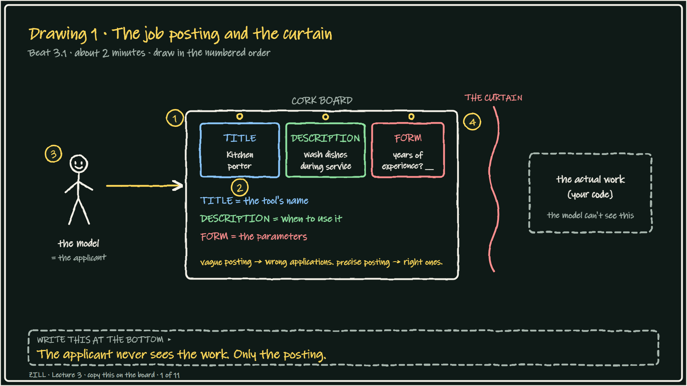
***Board sketch: the job posting and the curtain.** The model sees only the posting (title, description, form), never the work behind the curtain.*

### A tool has two halves

| Half | What it is | Who it is for |
|------|-----------|---------------|
| **Interface** | `name`, `label` (a name tag), `description`, `parameters` | The model |
| **Implementation** | Your function, which receives the filled-in parameters and does the real work | The machine |

The **description** matters most: it tells the model *when* to use the tool. Good description, right tool picked; poor one, wrong tool.

> Interview answer for "how do you define a tool?": *a tool has two halves, the interface the model reads and the implementation the harness runs.*

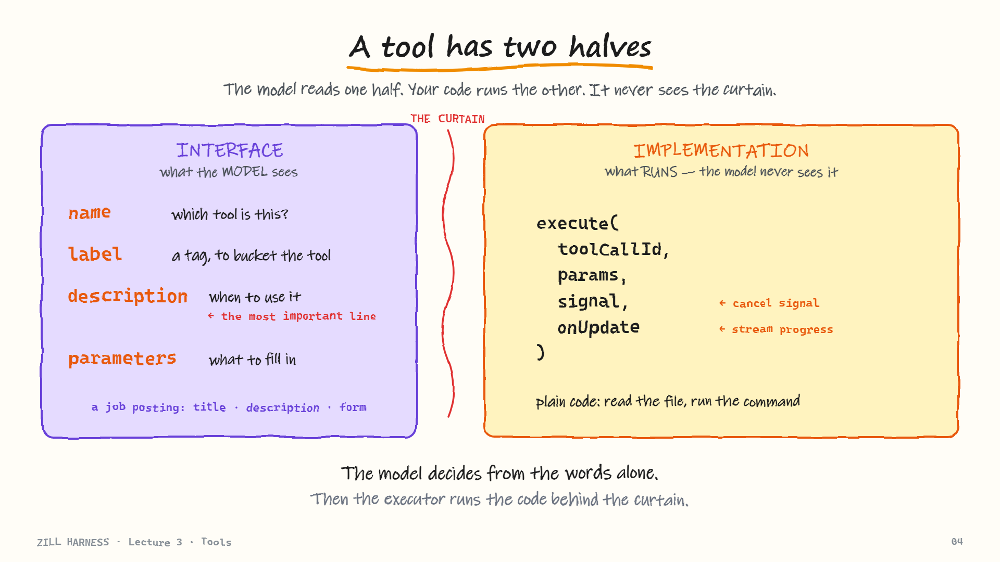
***A tool has two halves.** The model reads one half. Your code runs the other. It never sees the curtain.*

### A real contract, line by line

This is the `read_file` contract exactly as the model receives it. The model acts on these words and only these words.

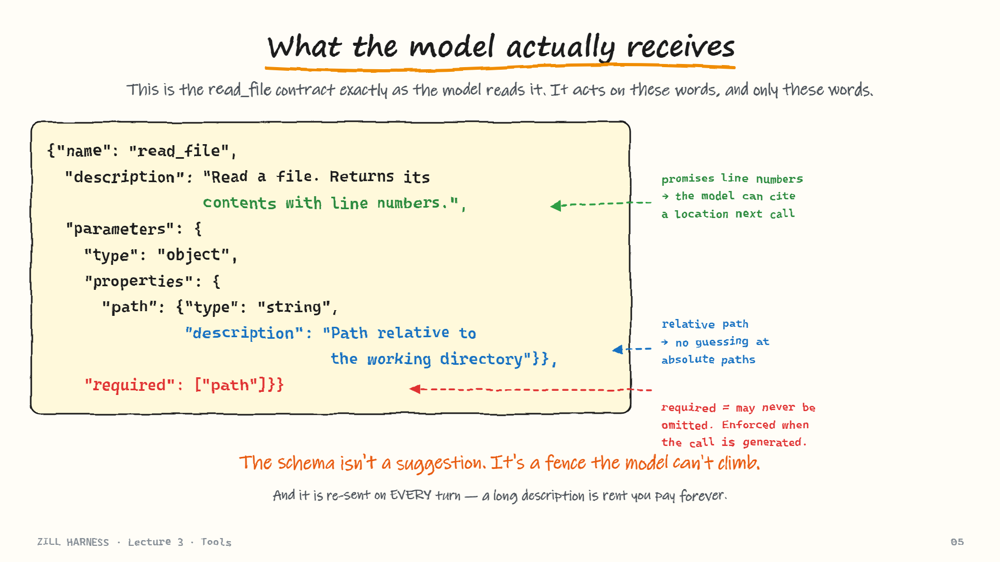
***What the model actually receives.** This is the read_file contract exactly as the model reads it. It acts on these words, and only these words.*

- **Name:** `read_file`.
- **Description:** "Read a file. Returns its contents with line numbers." Those last three words change behaviour: the model now knows it can say "look at line 12".
- **Parameter `path`:** with its own description, "relative to the working directory", so the model does not guess a strange path.
- **Required:** the model must fill `path`; it cannot skip it.

Two lessons. First, a contract is not a suggestion, it is a **fence**. Second, the whole text is sent **on every single turn**, used or not, so every extra word is paid for again and again. A good description says three things: what the tool does, what comes **back**, and any rule the model must follow.

### A bad contract and a good one

Same edit tool, two contracts:

| Loose | Tight |
|-------|-------|
| "Edit a file." One blank called `args` | "Replace an exact text snippet. It must appear once." Three blanks: `path`, `old_text`, `new_text` |
| The model has to guess what goes in `args`. It fails quietly, with no error | The model just fills in a form; it is hard to get wrong |

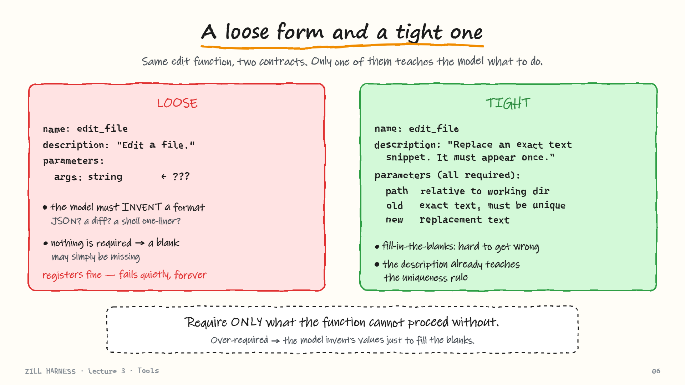
***A loose form and a tight one.** Same edit function, two contracts. Only one of them teaches the model what to do.*

Beginners think "mark everything required, it will be more reliable". It is the opposite: if a blank is required and the model has nothing real to put there, it will **invent** something. Mark as required only what the function truly needs.

**Rules for a contract**

1. One clear job.
2. Clear, named blanks (never one blank called `args`).
3. "Required" only for what is truly needed.
4. **If the model keeps misusing a tool, fix the contract.** Do not add more warnings to the system prompt.

---

# Part 2. The six tools

## Why only six

A developer's day comes down to six actions, so Zill has one tool for each:

| Action | Tool |
|--------|------|
| Look | `read_file` |
| Create | `write_file` |
| Fix | `edit_file` |
| Run | `bash` |
| Move around | `list_files` |
| Search | `grep` |

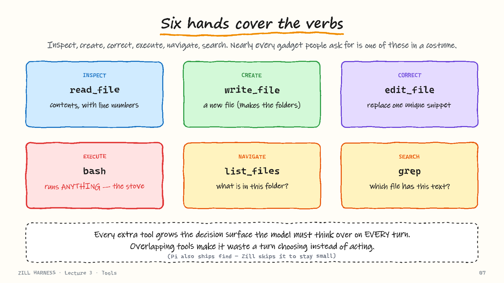
***Six hands cover the verbs.** Inspect, create, correct, execute, navigate, search. Nearly every gadget people ask for is one of these in a costume.*

Think of hiring a cook. You can hand over a drawer of forty gadgets, or give a few things that do everything: eyes to read the recipe, a pencil to fix it and a **stove** that cooks anything. Almost every gadget is the stove in a costume.

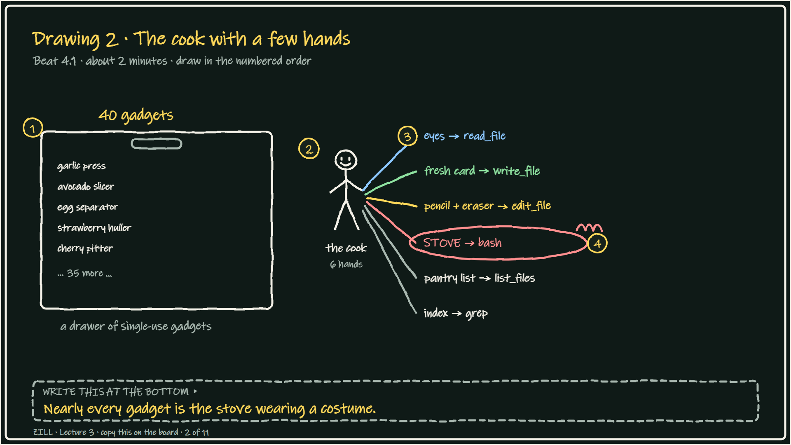
***Board sketch: the cook with few hands.** A few general tools beat a drawer of gadgets.*

"Why not a tool for running tests, one for git, one for installing packages?" Because those are all just `bash`; the model already knows the command. And every extra tool is one more option to weigh on every turn: more options, more confusion, more mistakes. **One tool, one job, and no two tools doing the same job.** (Pi has a seventh tool, `find`; Zill skips it to stay small.)

## Two rules for designing any tool

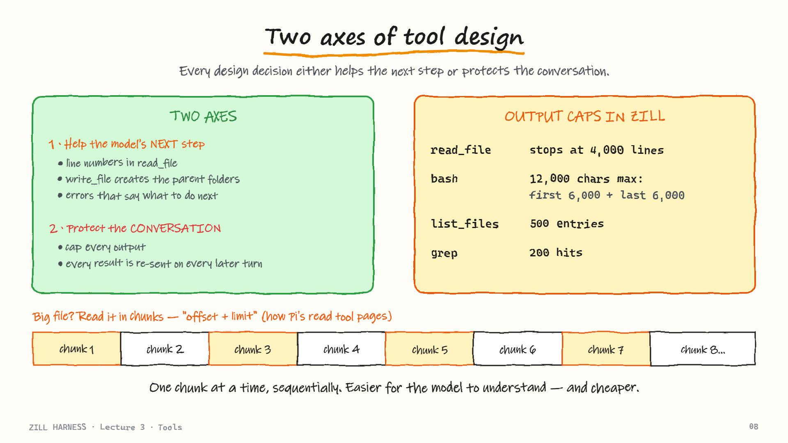
***Two axes of tool design.** Every design decision either helps the next step or protects the conversation.*

1. **Help the model's next step.** `read_file` returns line numbers so the model can point to an exact line later. `write_file` creates a missing folder so the model does not waste a turn on it.
2. **Keep the output small.** Everything a tool returns goes into the messages array, which is resent on every later turn, so one huge output is paid for again and again. Every tool therefore has a limit:

| Tool | Limit |
|------|-------|
| `read_file` | 4,000 lines (bigger files are read in chunks) |
| `bash` | first 6,000 + last 6,000 characters (in a long log the error is almost always at the end) |
| `list_files` | 500 entries |
| `grep` | 200 results |

## The edit tool

How `edit` is designed decides how reliable the agent feels. There are two ways to change a file:

| | Overwrite | Edit |
|---|---|---|
| The model sends | The whole file again | "Replace this old piece with this new piece" |
| Change 3 lines of a 500-line file | Retypes 500 lines, 497 of which it was not meant to touch | About 6 lines; the rest is never touched |

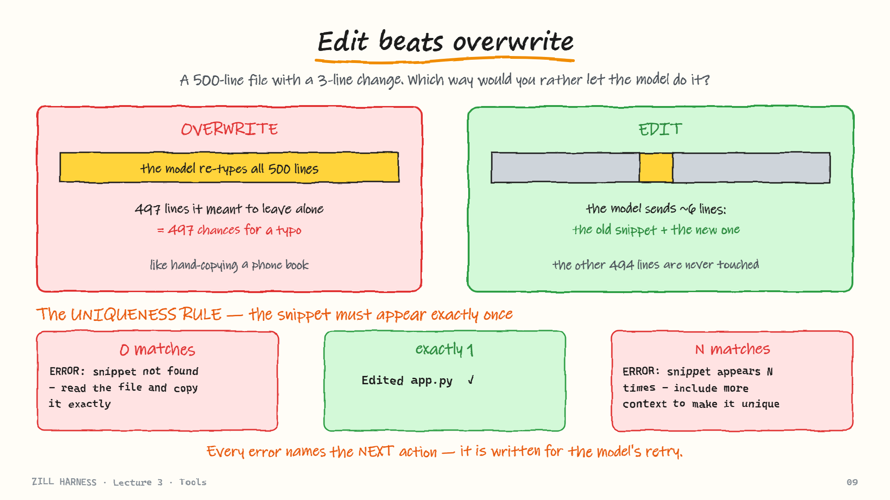
***Edit beats overwrite.** A 500-line file with a 3-line change. Which way would you rather let the model do it?*

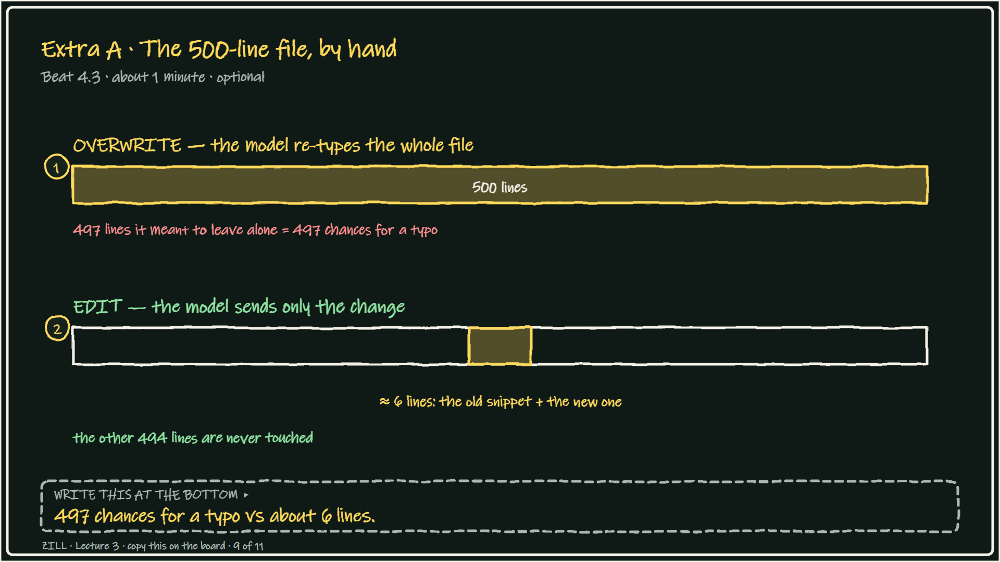
***Board sketch: the 500-line file.** Overwrite retypes everything; edit sends only the changed piece.*

Edit has **one rule: the old text must appear exactly once.**

| Occurrences | Reply to the model |
|-------------|--------------------|
| 0 | "Not found. Read the file and copy it exactly." |
| Many | "It appears N times. Give more context." |
| 1 | Make the change |

Notice each error says *what to do next*. **A tool's error message is written for the model, not for a human.** If it said only "Error. The snippet appears three times", the model would retry with the same text and fail again; the message, not the model, is the problem. Change only what you must, and when you refuse, say what to do next.

## bash: powerful and dangerous

The other five tools move text in and out of files. `bash` runs *programs*: tests, servers, git, installs. Most importantly, it lets the agent **check its own work**. Without it the agent can only say "I think it works".

The same tool can delete files, download and run something from the internet, or overwrite your team's work. So it ships with two guards before any security layer:

- **A timeout of 120 seconds**, so one stuck command cannot freeze the agent.
- **The output limit** above (first and last 6,000 characters).

A command that prints nothing returns a small "ran, no output" message rather than an empty reply, so the model is not left wondering.

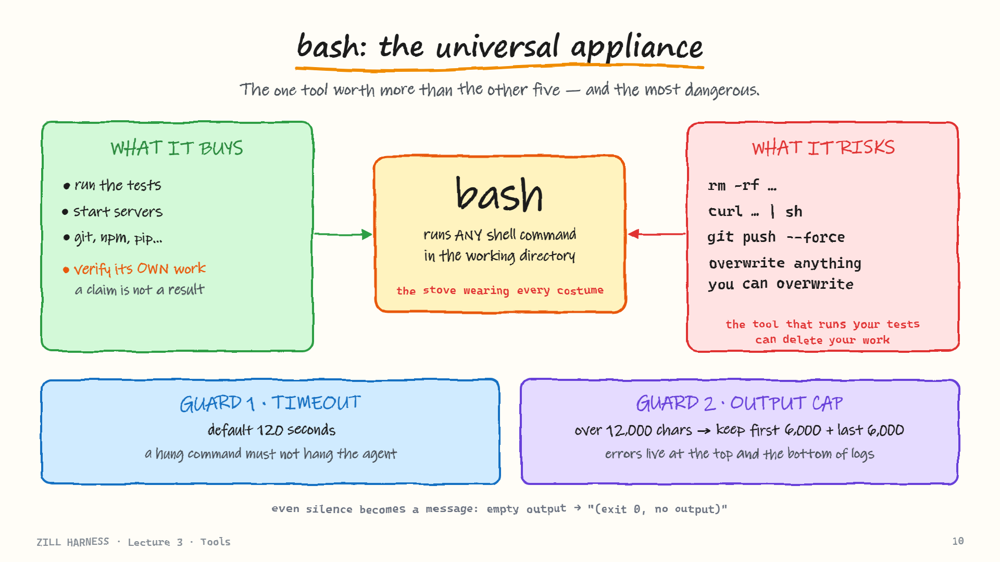
***bash: the universal appliance.** The one tool worth more than the other five — and the most dangerous.*

---

# Part 3. Keeping it safe

## Why security, and who stops a dangerous command?

One incident where a harness deletes someone's files and nobody uses it again. So security is part of the design from the first day, not a bolt-on.

Who stops a dangerous command? **Not the model.** If it believes deleting a folder will help, it will ask to delete the folder. It is the harness's job.

Picture an intern who types a hundred times faster than you, never tires and will run anything that might help. That is the model. Now picture an experienced colleague with a hand on the intern's shoulder, saying "wait, are you sure?" before anything risky. That is the harness.

> **The model asks. The harness decides.**

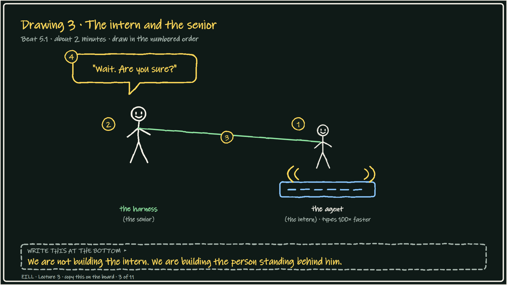
***Board sketch: the intern and the senior.** The model asks; the harness decides.*

## Three protections

| Protection | Decides |
|------------|---------|
| **The gate** | *What* is allowed to run |
| **The jail** | *Which folder* the agent can reach |
| **The backend** | *On which machine* the command runs |

---

## Protection 1: the gate

Before any tool runs, the call passes **one checkpoint**, every call, every time. This is what plugs into the `before_tool` socket. At the checkpoint three questions are asked **in a fixed order**:

1. **Is it on the "never" list?** If yes, stop here.
2. **Which mode are we in?** The mode decides whether this kind of action is automatically allowed.
3. **Does a human say yes?** Asked only if the first two could not decide.

Whenever a call is stopped, a message goes back that says *blocked* and gives the reason.

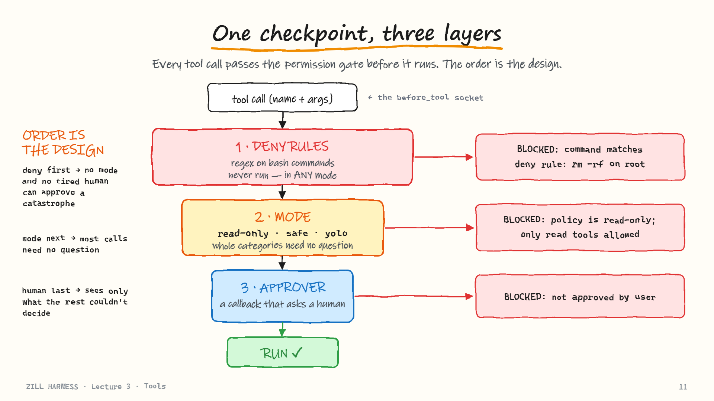
***One checkpoint, three layers.** Every tool call passes the permission gate before it runs. The order is the design.*

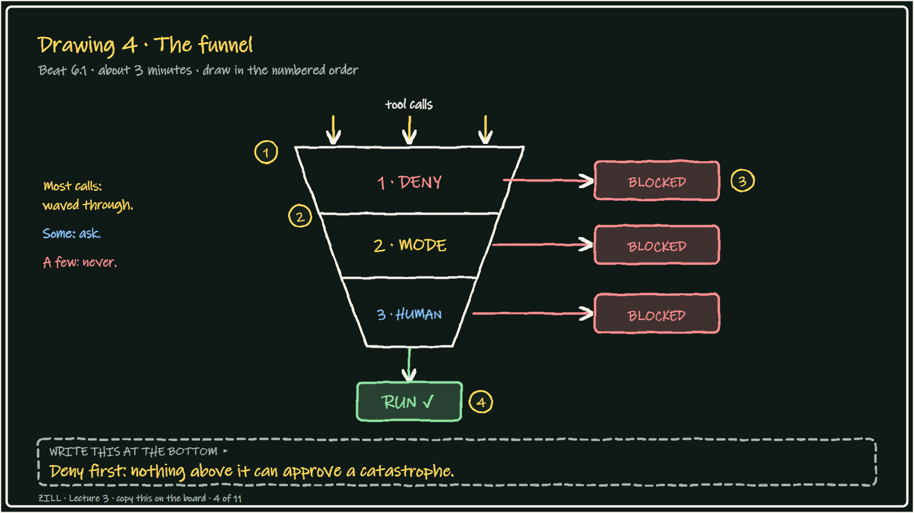
***Board sketch: the funnel.** Never list, then mode, then human.*

Why this order? With the never list first, **nothing can cancel it**: no mode, and no tired person clicking "yes" at 2 a.m. It is airport security: most people walk through, some are checked by hand, and a very few are never allowed on the plane.

### The three modes

| Mode | Behaviour | Use it when |
|------|-----------|-------------|
| **read-only** | The agent can read, list and search; it cannot change anything | You point it at a project for the first time and do not trust it yet |
| **safe** | Reading is automatic; anything that *changes* something (write, edit, bash) needs a human yes. **With no human connected the answer is no** | Normal everyday use. It fails safe |
| **yolo** | Everything is approved automatically | An agent running overnight with nobody to click yes, **but only in a safe place** |

Zill enforces that last condition: **choose yolo while bash runs directly on your own machine and Zill refuses.** The never list still applies in yolo. (Other coding agents have the same idea: a normal mode that asks, and a mode that skips questions.)

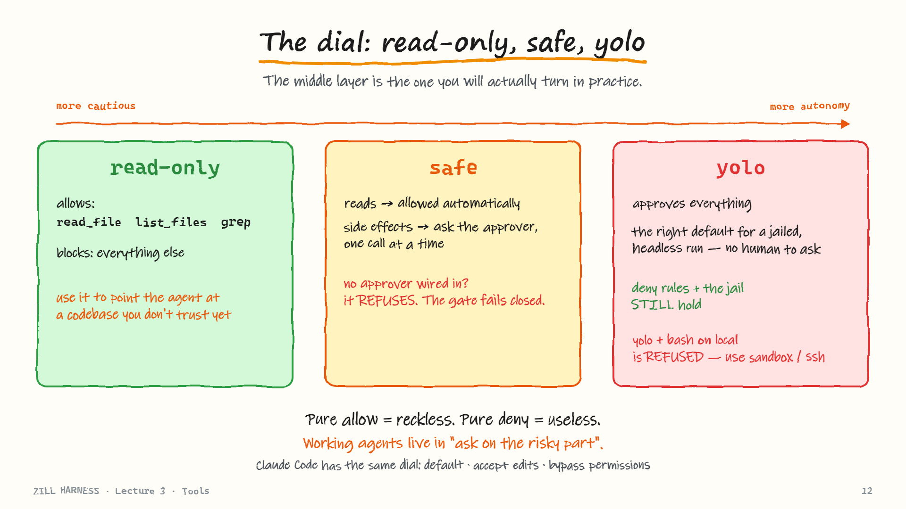
***The dial: read-only, safe, yolo.** The middle layer is the one you will actually turn in practice.*

### The "never" list

Six disasters, banned regardless of mode:

1. Deleting everything in your home folder or on a whole disk (`rm -rf` on `/`, `~` or `$HOME`).
2. `sudo`, which means full administrator power.
3. Disk-formatting and raw disk tools (`mkfs`, `dd if=`).
4. Downloading a script and running it immediately (`curl … | sh`).
5. `git push --force`, which can erase your team's work.
6. Writing directly onto a raw disk device (`> /dev/sd…`).

The list bans **disasters, not words**. Deleting a build folder inside your own project is normal work and is allowed.

What a block looks like: the user says "delete my home directory", the answer comes back *blocked: this command matches a rule on the never list*, and **nothing crashes**. The model reads the reason, says it should not do that and suggests something safer. **A refusal is information for the model, not an ending.**

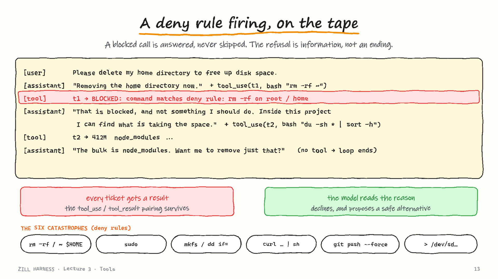
***A deny rule firing, on the tape.** A blocked call is answered, never skipped. The refusal is information, not an ending.*

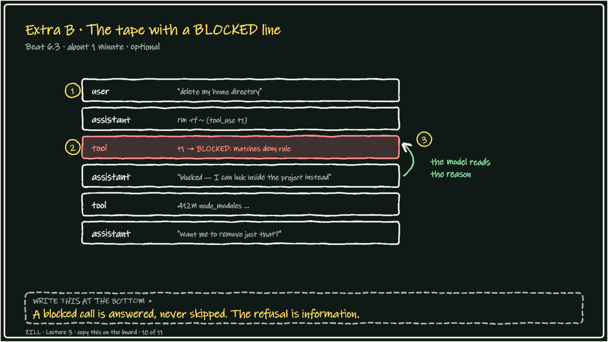
***Board sketch: a blocked call on the tape.** The refusal is recorded as a result and the loop carries on.*

These rules are patterns over text, and a clever command can sometimes slip past a pattern. The never list is a strong first wall, but **never your only wall**, which is why we need the next protection.

---

## Protection 2: the jail

The gate checks *what* a command is, not *where* it reaches. Reading a file is allowed, but which file? Your secret keys? Another project?

**The jail:** the agent may work in exactly one folder, the working directory. Inside it, it is free; outside (keys, system files, other projects) it can never reach. Every file path a tool touches goes through a three-step check:

1. Attach the path to the project folder.
2. Clean it up, removing tricks like `../` (go up one folder).
3. Ask: is the final path still inside the folder? If yes, go ahead; if no, stop with an error.

If the agent tries `../../etc/passwd`, that is again not a crash; the error goes back to the model as a message.

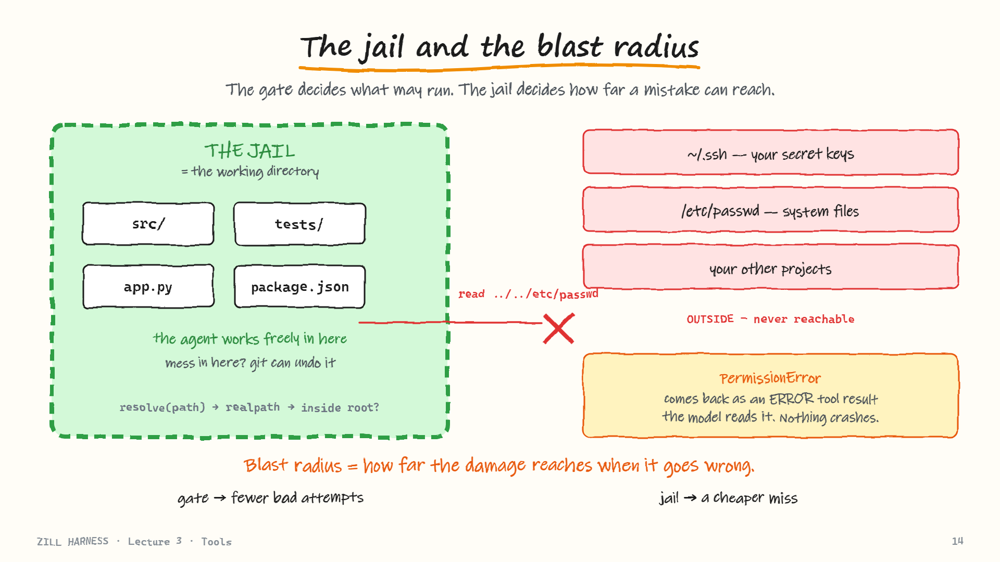
***The jail and the blast radius.** The gate decides what may run. The jail decides how far a mistake can reach.*

### Blast radius

A firecracker in a steel bucket does a few inches of damage. The *same* firecracker in a warehouse full of fireworks destroys the building. Same mistake, different result. The size of the damage is the **blast radius**.

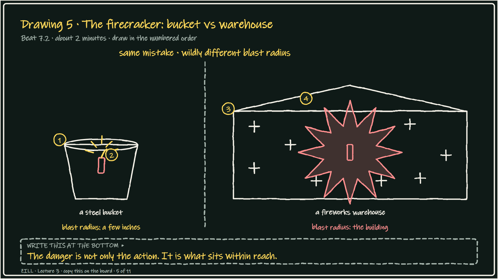
***Board sketch: firecracker, bucket versus warehouse.** Same mistake, different blast radius.*

We cannot stop the model making mistakes, but **we can control the room in which a mistake happens and keep it small**. The jail is the steel bucket.

### Why both the gate and the jail

| | Effect |
|---|--------|
| **The gate** | Bad actions happen *less often* |
| **The jail** | When a bad action does get through, the damage is *small* |

Something will always get through, because the model is fast and we are human. Picture three rings around the agent: the outer ring is the jail, the middle ring the never list, the inner ring the mode and the human. If one ring fails, the next holds.

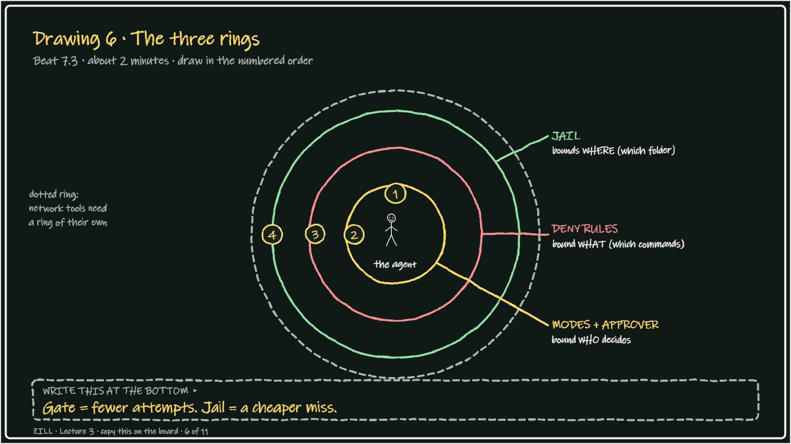
***Board sketch: three rings.** Jail, never list, mode and human.*

The question to ask of any agent is: **when the model is wrong, what is the worst thing that can happen?** For Zill: a mess inside one folder, which git can undo.

---

## Protection 3: the backend

Most people learn *what* a tool does and never ask *where it runs*. Pi separates the two. Under the tool sits a small switch with three places beneath it:

| Backend | What it is | Trade-off |
|---------|-----------|-----------|
| **Local** | Your own computer | Fastest, but for bash the riskiest, because your real files are there |
| **SSH** | A remote machine you connect to | If something goes wrong, it goes wrong there, not on your computer |
| **Sandbox** | A locked room inside your own computer | The command can touch only what is in the room |

You can pick the place for the **whole project** or **for each tool separately** (for example bash in the sandbox and read on your own computer). What a tool does and where it runs stay separate.

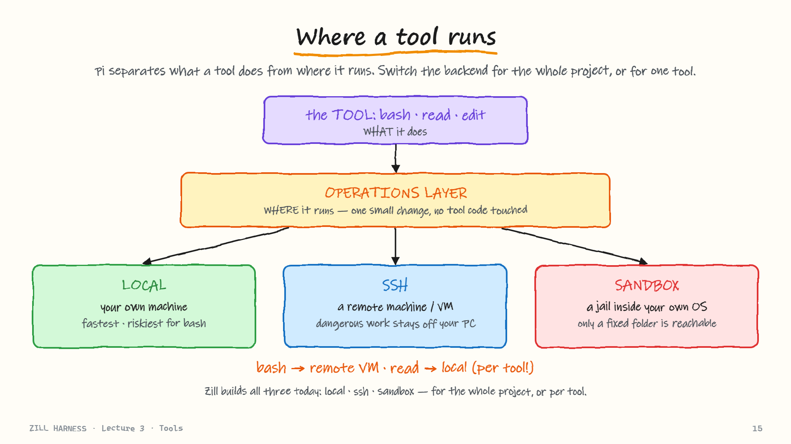
***Where a tool runs.** Pi separates what a tool does from where it runs. Switch the backend for the whole project, or for one tool.*

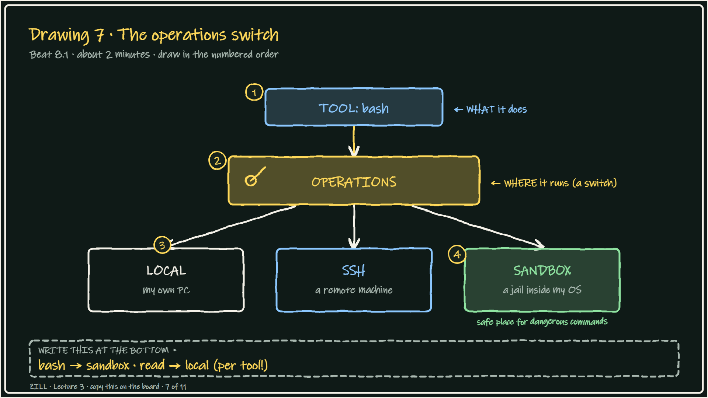
***Board sketch: the operations switch.** One tool, three possible places.*

### How Zill does it

Our tools never touch the disk or start a command themselves. They always ask a middle layer, **operations** (`operations.py`), "please read this file" or "please run this command", and operations passes the request to one of three backends. Two settings choose the backend: one for the whole project, one to override a single tool, and **the tool's code does not change at all**. Tools say *what* to do; operations decides *where*.

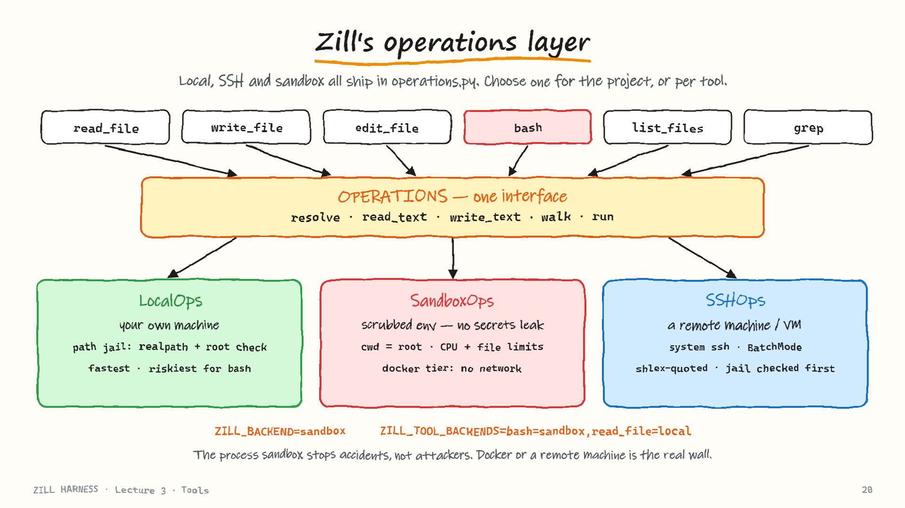
***Zill's operations layer.** Local, SSH and sandbox all ship in operations.py. Choose one for the project, or per tool.*

- **Local** runs on your computer, and the jail lives here.
- **Sandbox** runs the command in a clean room. Its most useful trick is that it **hides your secrets**: API keys normally sit in the computer's environment, and the sandbox does not pass them to the command.
- **SSH** runs the command on a remote machine with the ordinary `ssh` program.

### The honest limits

The normal sandbox stops **accidents**: a leaked secret, a command that never ends, a runaway file. It does **not** stop a determined attacker. For stronger isolation use the sandbox's Docker form (no internet inside), or run on a remote machine. The SSH backend as built here is tested against a fake server, so try it once on a small machine of your own before you trust it.

This explains the yolo rule: approving everything is acceptable only when the blast radius is small, so yolo with bash on your own computer is refused. **Know what your protection really does, and say it honestly.**

### Part 3 in one line each

- **Gate:** *what* may run: never list, mode, human.
- **Jail:** *where* it can reach: one folder.
- **Backend:** *which machine* it runs on: local, sandbox, remote.

---

# Part 4. The whole picture, then the build

## The journey of one tool call

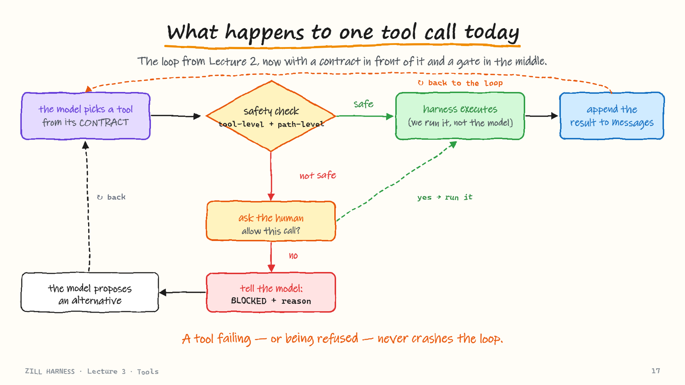
***What happens to one tool call today.** The loop from Lecture 2, now with a contract in front of it and a gate in the middle.*

Follow one call left to right:

1. The model reads the contracts and picks a tool (**part 1**).
2. The safety check: the gate and the jail (**part 3**).
3. If safe, the harness runs the tool, the result is appended to the messages array and the loop goes round again (**lecture 2**).
4. If not safe, we ask the human. Yes means run it; no means tell the model "blocked, and why", and the model suggests another way.

**No arrow ends in a crash.** A tool can fail or be refused, but the loop never crashes: the error becomes a message, and models are good at reading an error and correcting themselves.

## Three levels of security

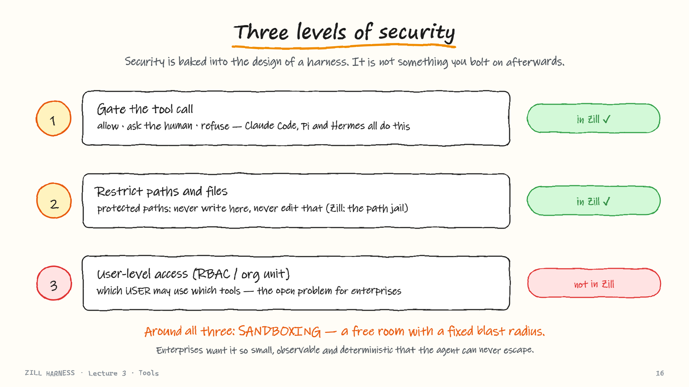
***Three levels of security.** Security is baked into the design of a harness. It is not something you bolt on afterwards.*

| Level | Control over | Status |
|-------|-------------|--------|
| 1 | The tool call (the gate) | Built today |
| 2 | Files and folders (the jail) | Built today |
| 3 | **The user**: which *person* may use which tool | Open gap: open-source harnesses do not do this and neither does Zill. Companies care about it, often more than agent cleverness |

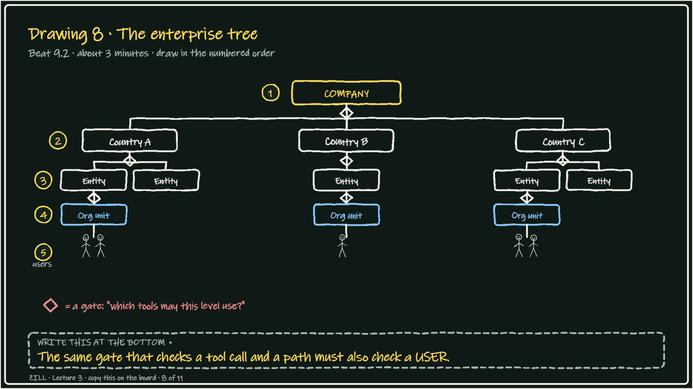
***Board sketch: the enterprise tree.** Countries, units and teams, each with different tool permissions.*

## Four levels of understanding "what is a tool?"

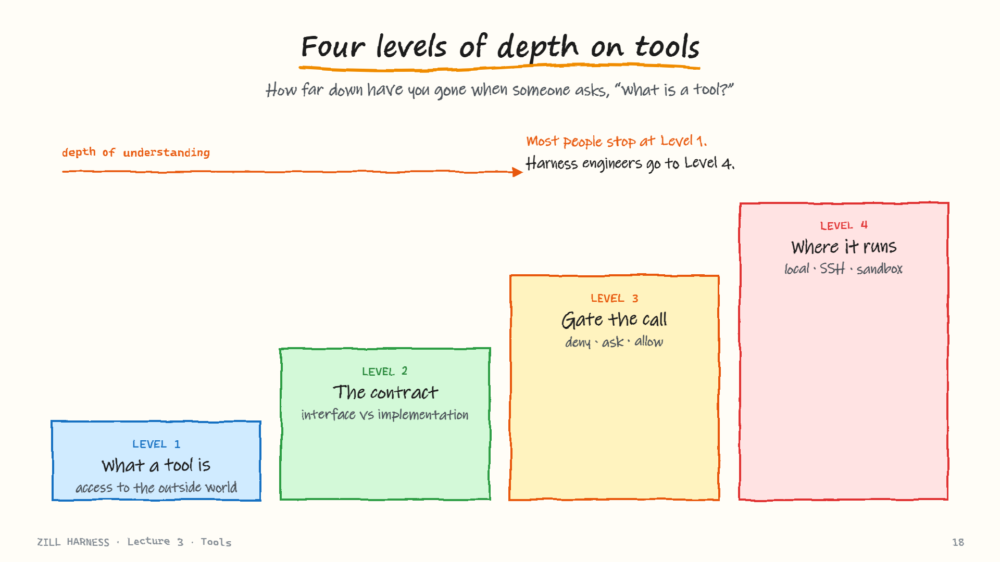
***Four levels of depth on tools.** How far down have you gone when someone asks, “what is a tool?”*

1. A tool lets the model access the outside world. Correct, and where most people stop.
2. You can explain the **contract**: interface and implementation.
3. You can explain how to **gate** a call: never, ask, allow.
4. You can explain **where** it runs: local, remote or sandbox.

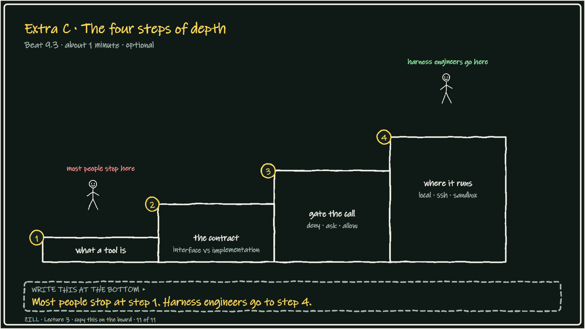
***Board sketch: four steps of depth.***

If asked to write a tool, do not just write a function: **first the contract, then the code, then the gate, then where it runs.**

## What we build

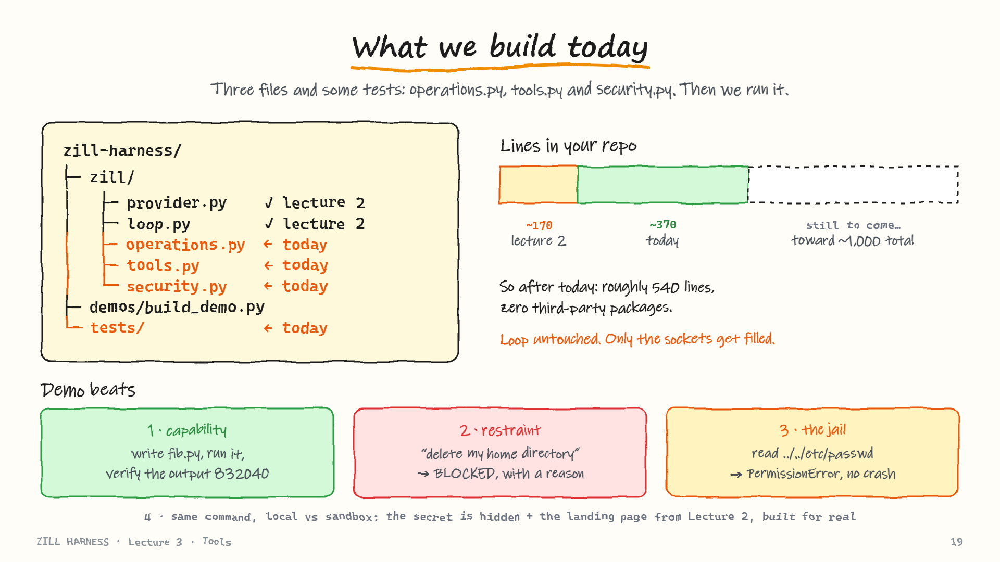
***What we build today.** Three files and some tests: operations.py, tools.py and security.py. Then we run it.*

Three files plus tests. `loop.py` and `provider.py` are **not touched**.

| File | Role |
|------|------|
| [`operations.py`](../code/zill-harness/zill/operations.py) | Decides where a tool runs (local, sandbox, SSH) |
| [`tools.py`](../code/zill-harness/zill/tools.py) | The six tools |
| [`security.py`](../code/zill-harness/zill/security.py) | The gate, the never list and the three modes |

As before, the code comes from a careful prompt given to a coding agent: [the Lecture 3 build prompt](../prompts/lecture-3-build-prompt.md). The prompt is organised in blocks: ground rules (no extra packages, do not change old files), operations, tools (with every error message written out), security, and a list of checks the agent must run and report honestly. Three habits make it a good prompt:

1. It is **exact**: it names functions and writes out error messages. The more exact, the better the result.
2. It **protects old work**: do not change `loop.py`; if you think it must change, stop and say so.
3. It asks the agent to **list what it did *not* protect against**, so weak points come to you instead of you finding them later.

### Five demos to run

| # | Demo | What you see |
|---|------|--------------|
| 0 | `python -m unittest discover -s tests -v` | Everything passes; a table shows which backend each tool uses |
| 1 | Create `fib.py` and run it | It writes, runs, reads the output and only then answers: it *checked* rather than guessed |
| 2 | "Delete my home directory" | **Blocked** by the never list; the model declines politely and offers something safer |
| 3 | "Read `../../etc/passwd`" | A permission error returned as a message; nothing crashes |
| 4 | Print a fake secret, first on the local backend then on the sandbox | Local prints it; sandbox prints nothing. Same tool, same code, only the place changed |
| 5 | "Build a landing page for a coffee shop" | This time it builds real files you can open, with no change to the loop |

## Homework

1. Run your harness in **read-only** mode on a project of your own and ask for a short guide: what it does and which three files a newcomer should read first.
2. Design a **seventh tool** for your own work, *contract first*: name, description, blanks and two error messages. Only then write the code.
3. Add one rule to the **never list** for your own work, something that would really hurt where you work, such as a deploy command.
4. Try to **break out of the jail** and see the error and what the model does next.

## Summary

- A tool lets the model touch the outside world.
- The model sees only the **words** of a tool, never the code, so write those words carefully.
- **Six tools are enough**; `bash` is the powerful and the dangerous one.
- Three protections: the **gate** (what may run), the **jail** (where it can reach), the **backend** (which machine).
- When the model is wrong, **the damage must stay small**.

Lecture 2 gave Zill a heartbeat; this lecture gave it hands and a conscience. Next, Zill meets its first real limit: the context fills up.
