# Lecture 4 — Context and compaction

> **Lecture 4 of 6 — context and compaction**
> 64 hand-drawn pictures, in order.

# PART 1 — What goes into the context

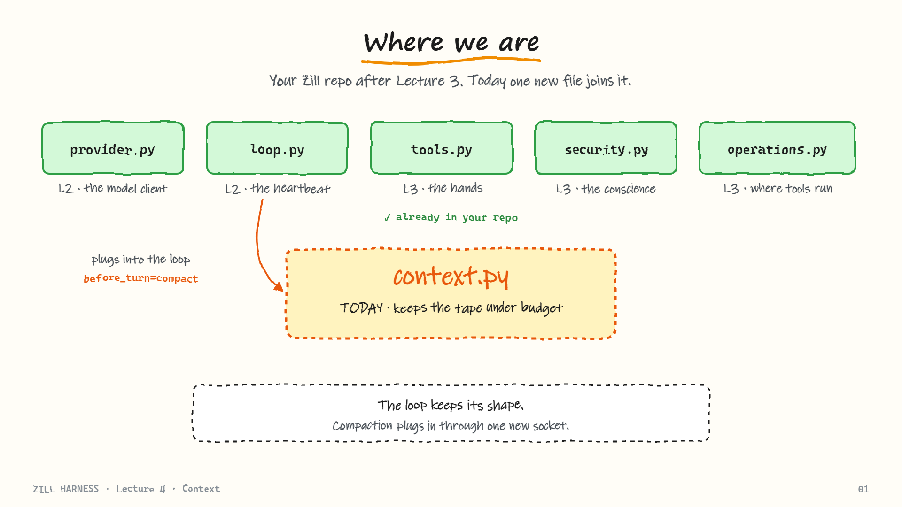
*Picture 01*

Alright everyone, welcome back to the Harness Engineering series. This is lecture number four.

Before we start today, I want you to open your Zill repository once and check where you are. It should look exactly like this picture.

From lecture two, you have provider.py. That's the only file that talks to the model provider. And you have loop.py, which is the heartbeat of the harness, the ReAct loop. From lecture three, you have tools.py, which gives Zill its hands. security.py, which is the conscience, the permission gate. And operations.py, which decides where a tool actually runs, on your local machine, over SSH, or in a sandbox.

If you have these five files, you are on the right track. If you don't, please go back and finish lecture three first, because today we are building directly on top of it.

Today we add one more file, context.py. And I'll be honest with you, I think today is probably the most important lecture of this whole series. Let me tell you why.

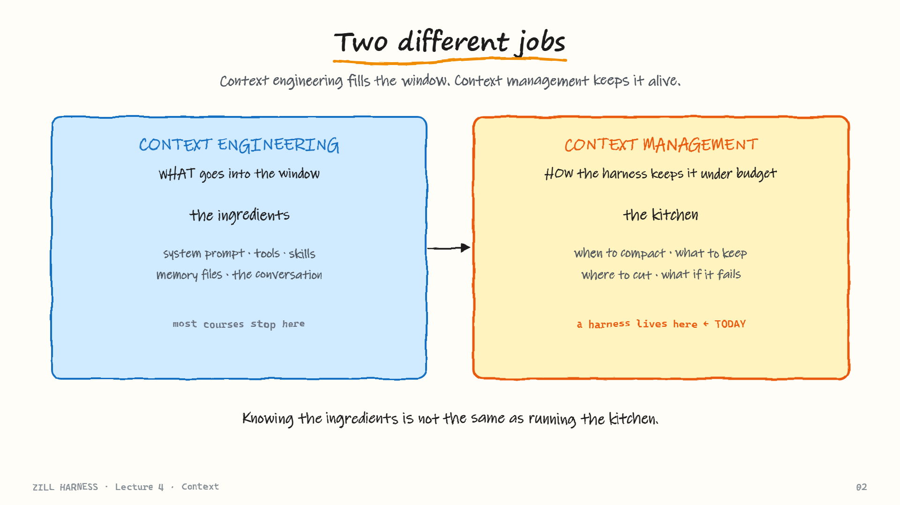
*Picture 02*

When people learn about context, what they usually learn is the elements of a context. The key components. What goes inside. The system prompt, the tools, the skills, the memory files, the conversation. This is called context engineering. Context engineering is the art and science of filling up the context properly. And that's important, no doubt.

But most courses stop right here.

When you are actually designing a harness, there is something much more important, and it's called context management. Context management is about how the harness keeps this context alive and under control, turn after turn, while the agent is working. When should it compact? What should it keep exactly? Where should it cut? And what happens if compaction itself fails?

And the most important part of context management is context compaction. Now, many of you might think compaction is simple, you just summarize the old messages and you're done. It is not as simple as that. Today we are going to open up how Pi does it, how Hermes does it, and how DeepSeek Harness does it. And you will see, it's extremely detailed. These harnesses have thought of so many things that look obvious once you see them, but nobody tells you about them.

And at the end of the lecture, we will build our own compaction into Zill.

---

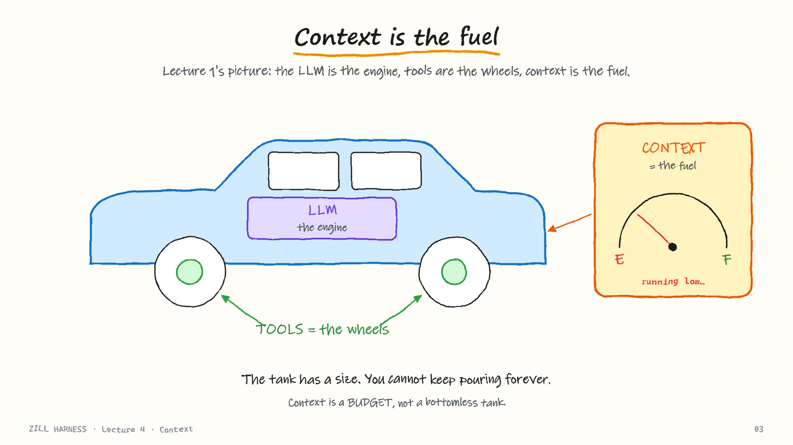
*Picture 03*

So let's start simple. What exactly is context?

In lecture one, we used the analogy of a car for a harness.

The LLM is the engine. It does the thinking.

The tools are the wheels. They let the engine actually move in the real world.

And the context is the fuel. Now think about fuel. What happens when it gets exhausted? It needs to be refilled. And the tank has a fixed size. You cannot keep pouring fuel forever. It's exactly the same with context. Every model has a fixed context window, say two hundred thousand tokens. You cannot keep adding things to it forever. So context is a budget. It's a very, very precious resource, and the harness has to manage it.

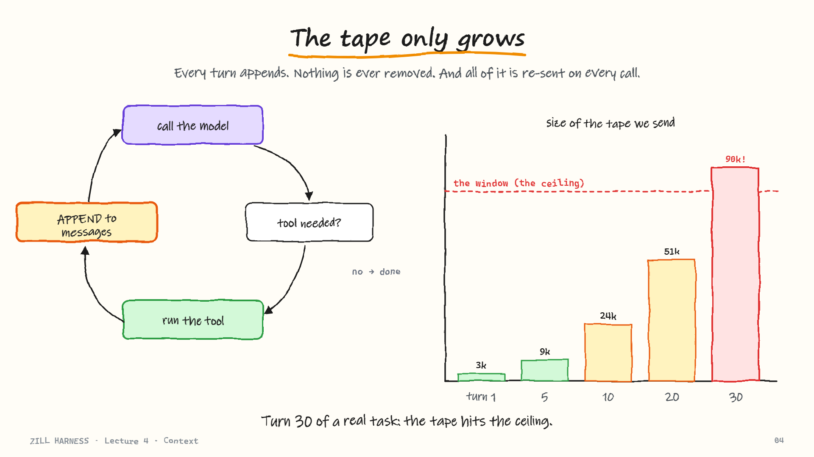
*Picture 04*

[ASK, wait 3 sec] Remember the loop we built in lecture two. Can you tell me the main arguments this loop takes? Pause the video and think.

The loop takes the messages array, and max turns. And of course it also gets the tools.

So what happens in the loop? We call the model. We check, does the model want to use a tool on this turn? If not, we stop and return the answer. If yes, we run the tool, the tool touches the outside world, we observe the result, and we append that result back into the messages array. And then we go round again.

Now look at the messages array. Every turn, the assistant's reply is appended. Every tool result is appended. Nothing is ever removed. So this array only grows. We call this array the tape. And the important thing is, on every single call, the whole tape is sent to the model again, because the model itself remembers nothing.

So look what happens. Turn one, maybe three thousand tokens. Turn five, nine thousand. Turn ten, twenty-four thousand. Turn twenty, fifty-one thousand. And by turn thirty of a real task, the tape crosses the ceiling, the context window. And then either the API call fails, or the harness starts silently dropping old messages, and the dropped message might be the original task itself.

And notice, nobody wrote a bug here. The loop is doing exactly what we told it to do. Append everything, forever. That rule is what gives the agent its memory, and that same rule is what kills it on a long task.

---

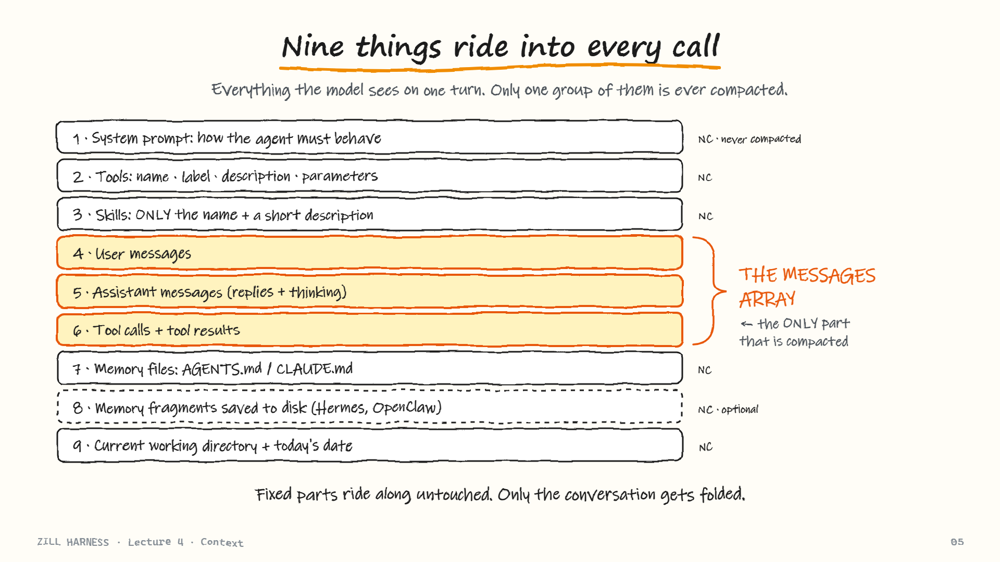
*Picture 05*

[ASK, wait 3 sec] So let's make a proper list. What do you think goes into the context every time we call the model? Pause the video and make your own list.

Number one, the system prompt. This tells the agent how to behave.

Number two, very important, the tools. And tools don't come as just names. They come with their whole contract, the one we learned in lecture three: the name, the label, the description, and the parameters. All of that goes in, for every tool, on every call.

Number three, the skills. But here is something very interesting. For a skill, the entire skill file is not put into the context. Only its name and a short description. So even if a skill file is a thousand lines of markdown, only one or two lines about it go in. The model reads that name and description, and decides whether it needs that skill. The full skill is loaded only when it's selected. This is called progressive disclosure, and we'll come to it in a few minutes.

Then numbers four, five and six. This is the messages array itself, and we can break it into three parts. The user messages, which is what you type. The assistant messages, which is what the model thinks and replies. And the tool calls with their tool results.

Number seven, memory. Now, when we say memory, there is short-term memory and long-term memory. The messages array is the short-term memory. Long-term, persistent memory is files like AGENTS.md or CLAUDE.md. When you work on a project, you might keep a CLAUDE.md file with instructions for that project, and it stays across all your sessions.

Number eight, and I'm writing this one as optional. Hermes and OpenClaw do something extra. After a conversation, they decide by themselves what was important to the user, and they save small memory fragments to disk. It can be your local computer, a VM, a database, anywhere permanent. Pi does not do this. Pi only has its AGENTS.md or CLAUDE.md file.

And number nine, which looks very small but is really important. The current working directory, and today's date. So the agent knows which folder it's in and what day it is.

Now here's the key question. Out of these nine things, which ones get compacted?

The system prompt is never compacted. I'm marking it NC, not compacted. The tools, never compacted. The skills, never. The memory files, never. The working directory and date, never.

Only these three, the messages array, are ever compacted. Nothing else in the context is touched. Keep this in your mind, because everything we discuss today is about how to compact just this part.

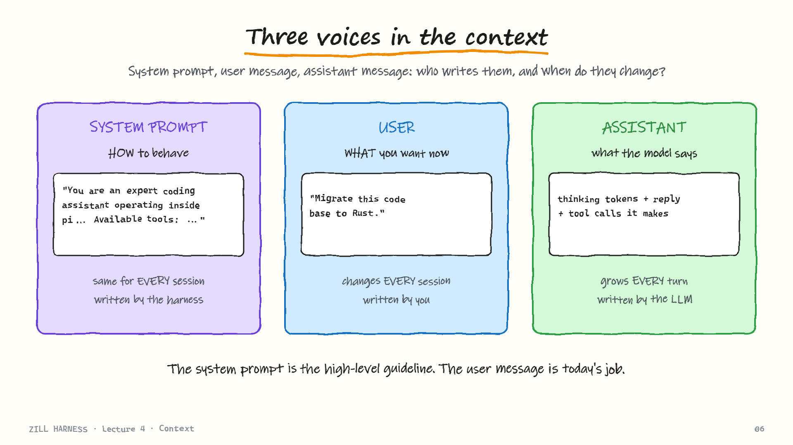
*Picture 06*

A question people always ask me is: what's the difference between a system prompt and a user message? Let me make that very clear.

The system prompt is something that tells the system how to behave. For example, Pi's system prompt starts like this: "You are an expert coding assistant operating inside pi, a coding agent harness. You help users by reading files, executing commands, editing code, and writing new files." And then it gives the list of available tools. That's it, it's actually a very small system prompt.

And this is fixed. Anyone who starts a new session in Pi gets this exact same text. It's a high-level guideline for the harness itself, written by the harness.

A user message is what the user asks in that particular session. For example, "migrate this code base to Rust". That's a user prompt, because I asked it in this session. Tomorrow I'll ask something else. But no matter what I ask, the system prompt is loaded as it is.

And the assistant message is what the LLM thinks and replies. Its thinking tokens, its answer, and the tool calls it decides to make. And this grows every turn.

---

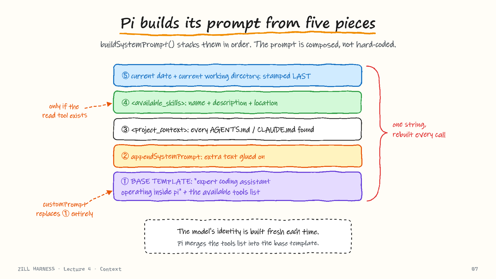
*Picture 07*

Okay. Now this list of nine components is fine for a context engineering class. But we are doing harness engineering. So the real question is, how does an actual harness like Pi assemble its context? Let's see what Pi does in practice.

The terminology here is a bit confusing, so listen carefully. When Pi says "system prompt", it doesn't mean one fixed paragraph. It means everything it assembles and sends to the model before the conversation. And it builds this with a function called buildSystemPrompt. This function stacks five pieces, in a fixed order.

Piece one is the base template. "You are an expert coding assistant operating inside pi", plus the available tools list. So what we called "system prompt" and "tools" in our list of nine, Pi merges these two together into this first piece.

Piece two is appendSystemPrompt. This is any extra text you want to glue on at the end of the base template.

Piece three is the project context. This is every AGENTS.md or CLAUDE.md file Pi finds. Can you tell me where this maps on our list of nine? Yes, this is the memory part. We'll look at how it finds these files in a minute.

Piece four is the available skills. Only the name, the description, and the location of each skill file. And look at this small note. This block is added only if the read tool is present. Why? Because to use a skill, the model has to read the skill file. If it can't read files, there's no point telling it about skills.

And piece five, stamped last, the current date and the current working directory.

All five pieces become one single string. And this string is rebuilt on every call. Also, if you give Pi a customPrompt, it replaces the base template completely. So the model's identity is not hard-coded anywhere. It's built fresh, every single time.

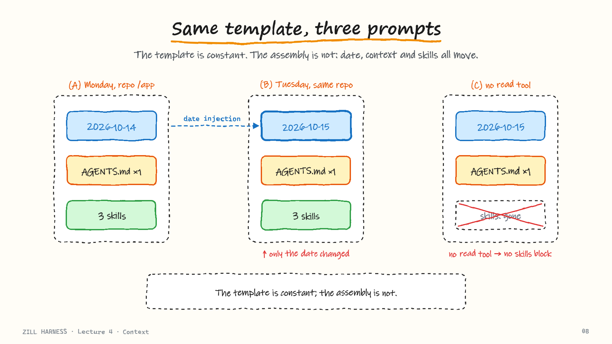
*Picture 08*

Why does rebuilding every time matter? Look at these three examples.

Example A. Monday, in a repo called app. The date says the fourteenth. One AGENTS.md is found. Three skills are available.

Example B. Tuesday, same repo. What changed? Only the date. That's called date injection. Everything else is the same.

Example C. Same day, but now the read tool is switched off. And the skills block is simply gone, because the model can't open a skill anyway.

So the template stays constant. But the assembled prompt keeps moving with the date, the files and the skills.

---

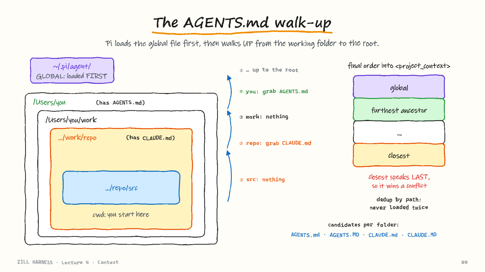
*Picture 09*

Now let's zoom into piece three, the project context. Because there's a really nice detail here that people miss.

Think about how people actually work. At a higher level, you might have one AGENTS.md file which says how you generally like to do all your projects. Then inside one specific project, you have a CLAUDE.md with the instructions for that project. In another project, maybe you're using a different harness, so there's a different file. So these files are spread across different folders.

What Pi does is that it gathers files from two sources. First, the global file, from Pi's own agent folder in your home directory. That's your personal, cross-project standing instructions, and it goes in first.

Then it walks up. It starts at your current working directory. Here, that's the src folder. Nothing there. Then it checks the parent, the repo folder. It finds CLAUDE.md and grabs it. Then the parent of that, work. Nothing. Then the parent, your user folder. It finds AGENTS.md and grabs it. And it keeps going, all the way up to the root of the file system.

And in every folder it checks four file names, in this order: AGENTS.md, AGENTS.MD in capitals, CLAUDE.md, and CLAUDE.MD. This is actually written in Pi's code.

Now look at the final order these files go in. Global first. Then the furthest ancestor folder. And the closest file, last.

Why last? Because the file closest to your project is the most specific one, so it should have the final word. If two files contradict each other, the one closest to your local repo wins.

And one more detail. Pi dedups by path. So a file that's already loaded is never counted twice.

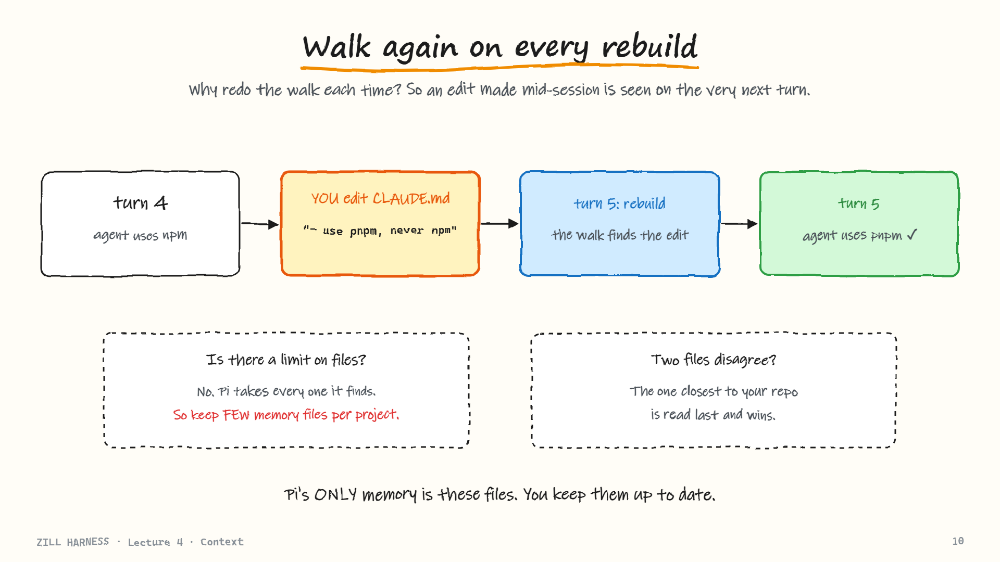
*Picture 10*

[ASK, wait 3 sec] Here's a question. Why do you think Pi does this walk again every time it rebuilds the prompt? Why not just once at the start?

Because you can edit these files in the middle of a session.

Look at this timeline. On turn four, the agent is using npm. Now you open CLAUDE.md, in the middle of the session, and add one line: "use pnpm, never npm". On turn five, the prompt is rebuilt, the walk runs again, it finds your edit, and now the agent uses pnpm.

In fact, if there's an important memory you want the agent to keep, you can just write it into your CLAUDE.md mid-session. So the walk has to happen every time, so that whatever you change is captured immediately.

Someone might ask, is there a limit on how many markdown files Pi takes? No, there's no limit. So be careful. If you keep too many markdown files in one project, Pi will collect all of them, and you'll confuse the model.

And if two files disagree, the one closest to your repo is read last, and it wins. But ideally, don't have contradictions in the first place.

And one honest point about Pi here. These files are Pi's only memory. Pi has no separate system for memory. It relies on you, every single time, to update this CLAUDE.md with the things you think are important. That's a design choice. Pi wants to stay minimal.

---

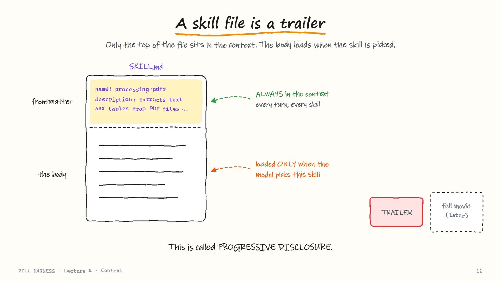
*Picture 11*

Next, we come to a very, very important thing, which is skills. A lot of people are really confused about skills. So let me make it very simple.

A skill is one markdown file, called SKILL.md. At the top, it has a small labelled section called the frontmatter. It has two things. A name, here "processing-pdfs". And a description, here "Extracts text and tables from PDF files".

Below that is the body. The real instructions. This can be long, hundreds of lines.

Now here is the key idea. When the context is built, the body is never added. Only the name and the description go into the context. Every turn, for every skill. The body is loaded only when the model selects that skill.

So it's your job to write the name and the description really well. Because the model has to choose which skill to use based only on these two things.

Think of it like a movie trailer. The trailer is short. It tells you what the movie is about. You watch the full movie only if the trailer makes you want to. The name and description are the trailer. The body is the full movie.

This idea is called progressive disclosure. You disclose the skill progressively, little by little, only when it's needed.

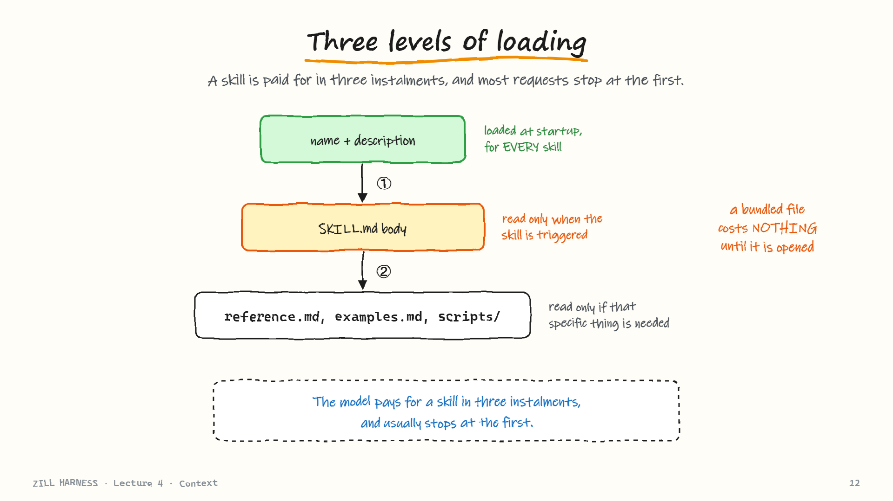
*Picture 12*

And actually, it's not just two levels. There are three.

Level one, the name and description. Loaded at startup, for every single skill.

Level two, the body of SKILL.md. Read only when the skill is triggered.

Level three. A skill can also point to other files, like a reference file, an examples file, or a scripts folder. These are read only if that specific thing is needed for this task.

So you can bundle as many files as you like with a skill. A bundled file costs nothing until it's actually opened. The model pays for a skill in three instalments, and most of the time it stops at the first one.

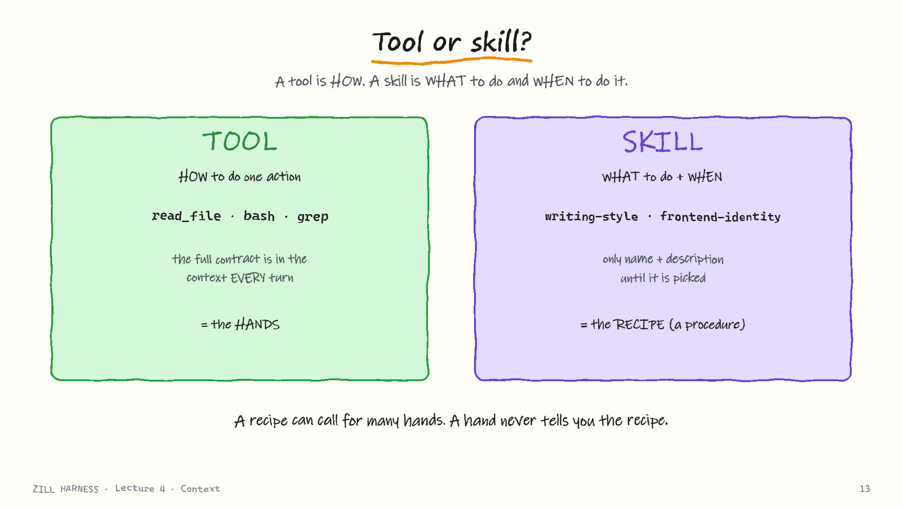
*Picture 13*

[ASK, wait 3 sec] Let me check if this is clear. What's the difference between a tool and a skill?

A tool is how to do one action. Read a file. Run a bash command. Search with grep. And its full contract is in the context every turn. Tools are the hands.

A skill is what to do, and when to do it. It's a procedure, a set of steps, like a recipe. And only its name and description are in the context until it's picked.

So a skill is the what and the when. A tool is the how. A recipe can call for many hands, but a hand never tells you the recipe.

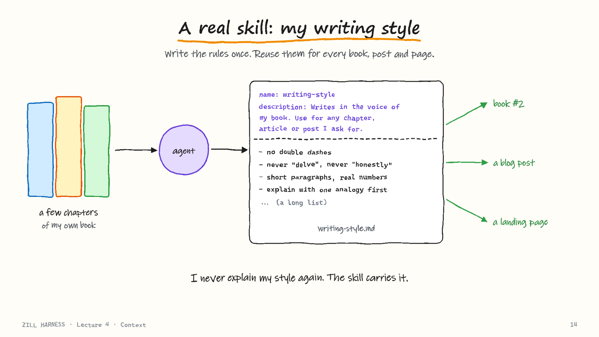
*Picture 14*

Let me give you a real example of a skill I made myself.

I was building a product with a writing agent. And the problem was, whatever it wrote, it looked AI-generated. You know the classic mistakes. Double dashes everywhere. Words like "delve", or "honestly". I did not want any of this. I wanted it to write the way I write.

So what I did is, I gave my agent a few chapters from my own book, and I asked it to create a skill file from them.

And the agent came back with a markdown file called writing-style.md. It had a name, a description, and then a big list of rules. No double dashes. Never "delve". Short paragraphs, real numbers. Explain with one analogy first. And so on.

Now every time this agent runs, this skill is loaded. So next time I want to write a new book, I don't have to explain my style again. A blog post, a landing page, anything. You write one skill once, and you can use it for any number of tasks.

And this is my own philosophy about harnesses. The core of the harness should be very small. And the real power should come from the skill files you write, and the way you write them. Hermes takes a different approach. It ships with a big core and a lot of skill files already built in. Both approaches are valid. But for your own product, the best skills come from your own experience. That's how your product becomes yours.

---

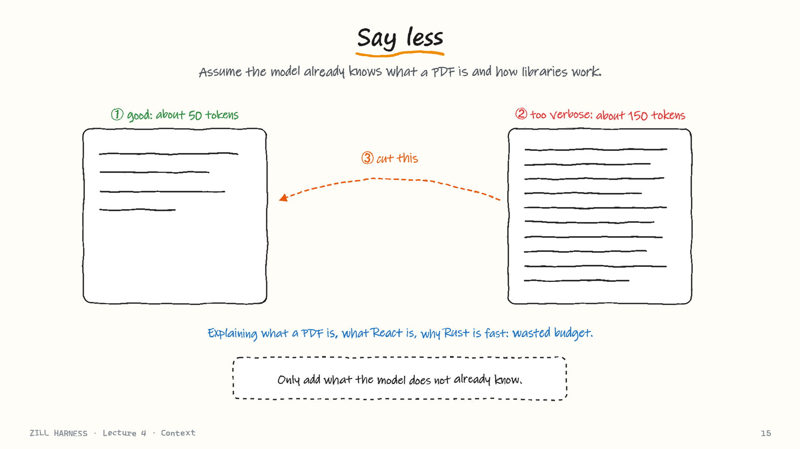
*Picture 15*

So now the real question. How do you write a good skill file? What does "good" even mean?

The rules I'm going to show you come from Anthropic's own guide on authoring skills. It's a very densely written document, so I've distilled the key points into pictures.

Rule number one. Say less.

The model already knows a lot. It knows what a PDF is. It knows how libraries work. It knows what React is, what Rust is, why Rust is fast. So you don't need to explain any of that in your skill.

Look at these two. The good one says what's needed in about fifty tokens. The verbose one says the same thing in a hundred and fifty tokens, because it also explains what a PDF is and why libraries exist. That's wasted budget.

Remember, the context window is shared. Your skill sits next to the system prompt, the conversation, and every other skill. So writing a skill is really a budgeting exercise. For every paragraph, ask: does this justify its token cost? If something is common knowledge, cut it.

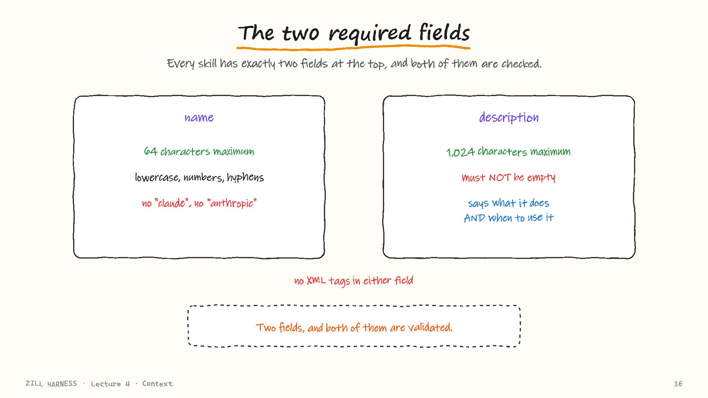
*Picture 16*

Next, the two required fields at the top. First, the name. Maximum sixty-four characters. Only lowercase letters, numbers and hyphens. And you're not allowed to use the words "claude" or "anthropic" in it.

Second, the description. Maximum one thousand twenty-four characters. It must not be empty. And it must say what the skill does, and also when to use it.

And no XML tags in either one. Both fields are actually validated, so if you break these rules, the skill won't load properly.

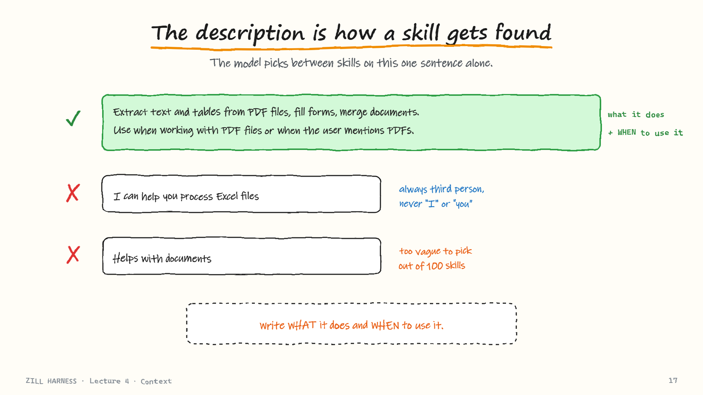
*Picture 17*

Now, the description is probably the most important line you'll write in the whole skill. Here's why. There are only two ways a skill gets found: the name and the description. That's all the model sees. If the description is bad, your skill will never be picked, no matter how good the body is.

Look at the good one. "Extract text and tables from PDF files, fill forms, merge documents." That's what the skill does. Then: "Use when working with PDF files or when the user mentions PDFs." That's when to use it. You need both halves. Most people only write the first half.

Now the bad ones. "I can help you process Excel files." Always write the description in third person. Never "I", never "you".

And "Helps with documents". This is far too vague. Imagine you have a hundred skills. How will the model pick this one? The model chooses between skills on this one sentence alone.

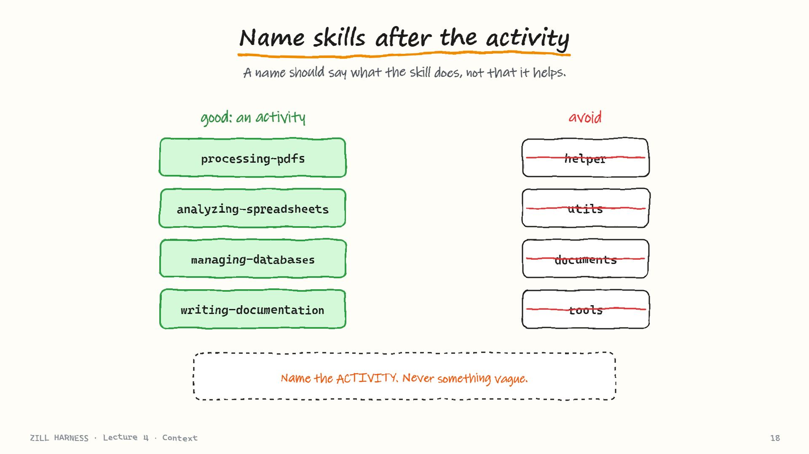
*Picture 18*

And the same goes for the name. Name the skill after the activity it does. Processing PDFs. Analyzing spreadsheets. Managing databases. Writing documentation.

Never use vague names like helper, utils, documents, or tools. A name should say what the skill does, not just that it helps.

---

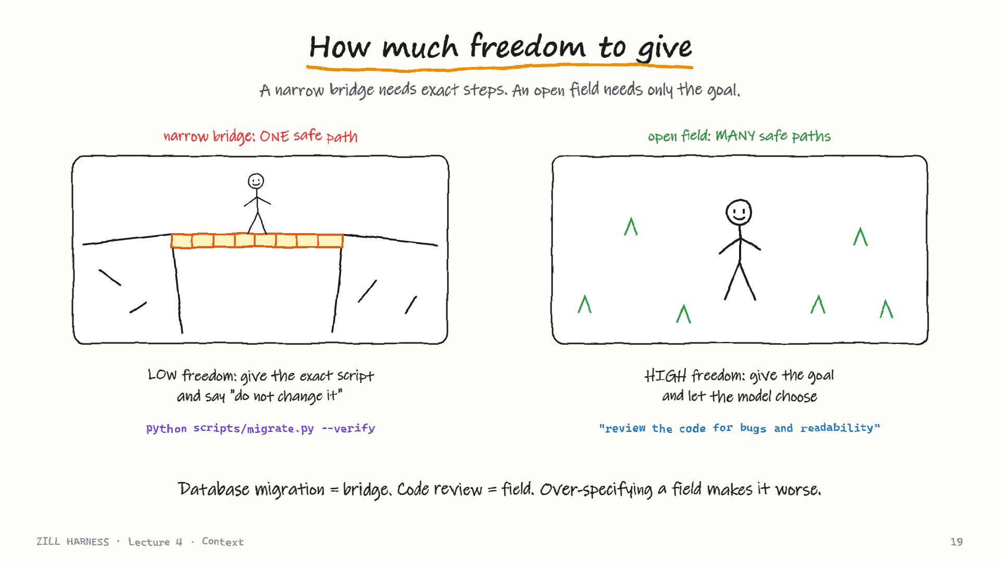
*Picture 19*

Now this next rule is a bit non-intuitive. When you write the body of the skill, how detailed should you be? How much freedom should you give the model?

Anthropic uses a really nice picture for this.

Some tasks are like a narrow bridge, with a cliff on both sides. Only one path is safe, and everything else fails. A database migration is like this. Or something very specific to your company or your organization. For these tasks, give low freedom. Write the exact steps, or even give an exact script, and say "do not change it". So it happens in a deterministic way, every time.

Other tasks are like an open field. There are many safe paths, and the right one depends on what the model finds. A code review is like this. For these tasks, give high freedom. Just give the goal, like "review the code for bugs and readability", and let the model choose how.

And here's the non-intuitive part. If you over-specify an open-field task, the skill actually becomes worse. You're taking away the model's judgment where it's actually useful.

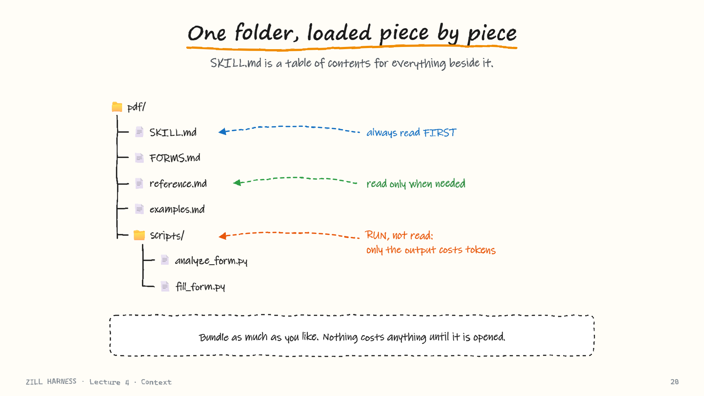
*Picture 20*

Next, how long should a skill be?

Generally, keep the body of SKILL.md under about five hundred lines. If it becomes bigger than that, split it into separate markdown files in the same folder. The main idea is, don't make huge skill files unnecessarily.

Look at this pdf skill folder. SKILL.md is always read first. FORMS.md, reference.md and examples.md are read only when they're needed. And the scripts folder is special. Scripts are run, not read. So the model doesn't spend tokens reading the script code. Only the output of the script costs tokens.

So SKILL.md works like a table of contents for everything in the folder. Bundle as much as you like, because nothing costs anything until it's opened.

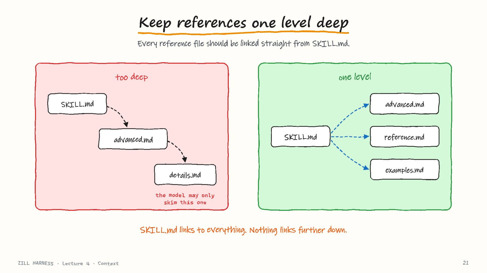
*Picture 21*

But be careful with how you link these files. On the left, SKILL.md points to advanced.md, and advanced.md points to details.md. That's two levels deep. This is difficult for the model to follow. It may only skim that last file and miss what's inside.

On the right, SKILL.md points directly to every file. One level deep. That's what you want. Every reference file should be linked straight from SKILL.md, and nothing should link further down.

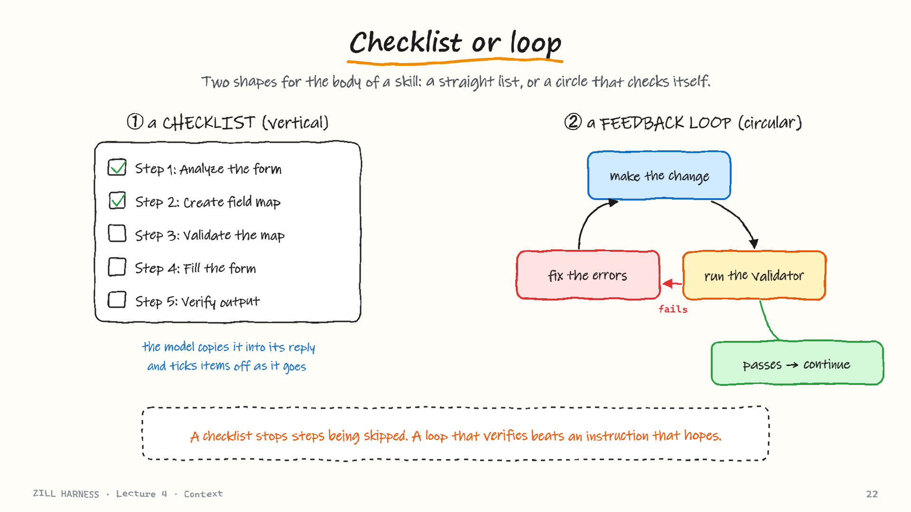
*Picture 22*

Now this one, I personally find the most useful of all, and honestly not many people know about it.

If your skill has many steps, give it a checklist. Step one, analyze the form. Step two, create the field mapping. Step three, validate the mapping. Step four, fill the form. Step five, verify the output. And you tell the model: copy this checklist, and mark each step as done as you go. The model copies it into its reply and ticks things off. A written checklist stops steps from being skipped. This is a vertical pattern, a straight line.

The second pattern is a circle. A feedback loop. Make the change. Then run a validator. If the validator reports errors, fix them, and run the validator again. And only continue when it passes.

So the skill checks its own work. It never just runs and hopes. Most people write a skill as one instruction and move on. But if you put a feedback loop inside your skill, the skill will never move forward without reading its own output. And the more feedback loops you have in your skills, the more robust your whole product becomes.

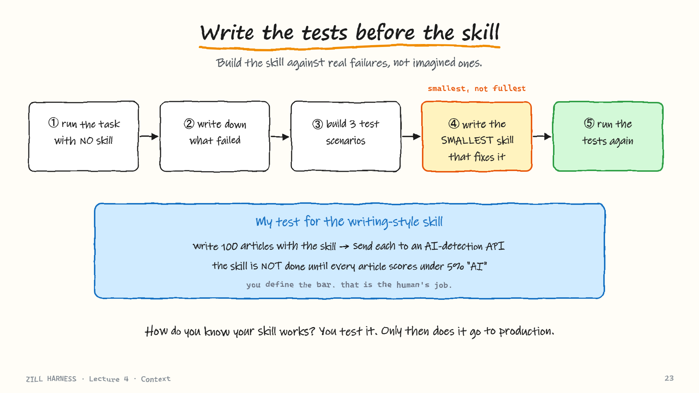
*Picture 23*

[ASK, wait 3 sec] Okay, you wrote a skill. How do you know it's actually working?

You have to test it. And Anthropic's advice actually reorders the whole process: write the tests before you write the skill.

Step one, run the task with no skill at all. Step two, write down exactly what failed. Step three, build a few test scenarios from those failures, say three. Step four, write the smallest skill that fixes them. Smallest, not fullest. And step five, run the tests again.

Let me tell you what I did for my writing-style skill. I used that skill to write about a hundred articles. Then I passed every single article through an AI-detection API. And I gave one clear rule: this skill is not done until every article scores under five percent AI. Only once that happened for all hundred articles did I know my skill was working. And only then did I put it into production.

And notice one thing. I defined that bar. Not the model. That's where the human comes in. Don't just tell the model "design your own criteria". You have to take the effort to define what "good" means.

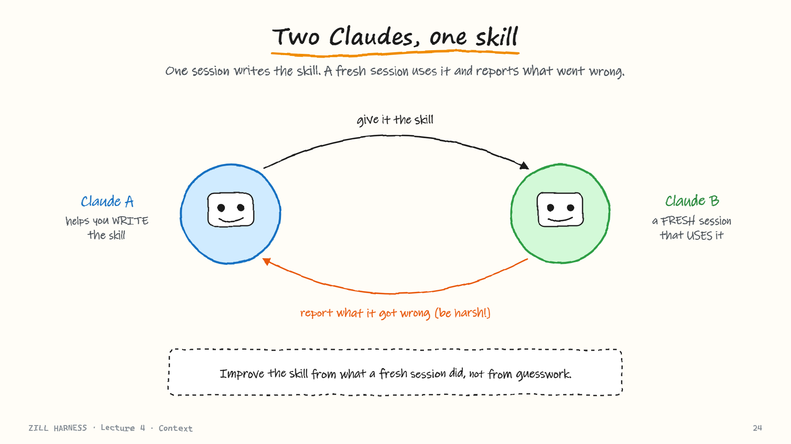
*Picture 24*

And one more simple trick, which almost nobody uses.

Use one Claude session, Claude A, to help you write the skill.

Then open a completely fresh session, Claude B. It knows nothing about how the skill was written, so it's not biased. Give it the skill, let it use it on real tasks, and tell it to be highly critical. Report everything that went wrong.

Then go back and improve the skill based on what Claude B actually did. Not from guesswork.

It's like a small competition. One writes, one judges, and the writer is never "done" until the judge passes it. It's the same idea as GANs, generative adversarial networks. It's such a simple idea, but it makes your skills much better.

---

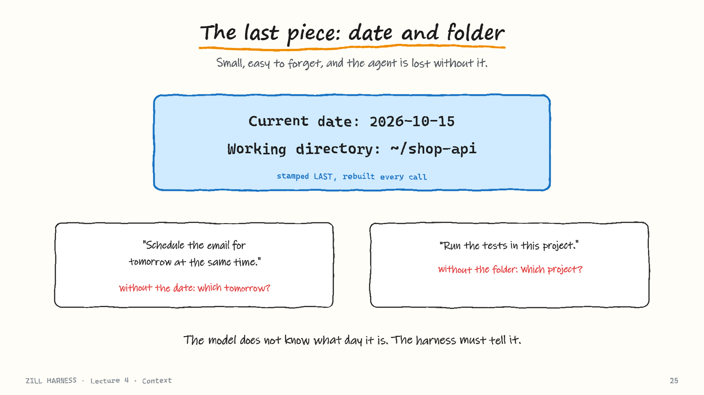
*Picture 25*

We covered four of Pi's five pieces. Now the last one, which looks very small. The current date and the working directory.

Say you tell your agent, "schedule this email for tomorrow at the same time". Which tomorrow? The model doesn't know what today is. It was trained months ago.

Or you say, "run the tests in this project". Which project? It needs to know the folder.

So all of this has to come from the harness. The harness must bake the current date into the prompt. Many people forget this, but it's really important.

So let's quickly lock in part one. One: nine things go into every call, but only the conversation, the messages array, is ever compacted. Two: Pi assembles its prompt fresh on every call, from five pieces: base template, appended text, project context, skills, and the date with the folder. Three: skills use progressive disclosure. Only the name and description are always loaded. And a good skill is short, easy to find, has feedback loops, and is tested.

[PAUSE] (If you want two videos, end video 1 here.)

# PART 2 — Compaction: Pi vs Hermes

Now comes the part which I really think very few people know. Because not many people have actually gone into the code of Pi and Hermes and compared them side by side. We're going to do that now.

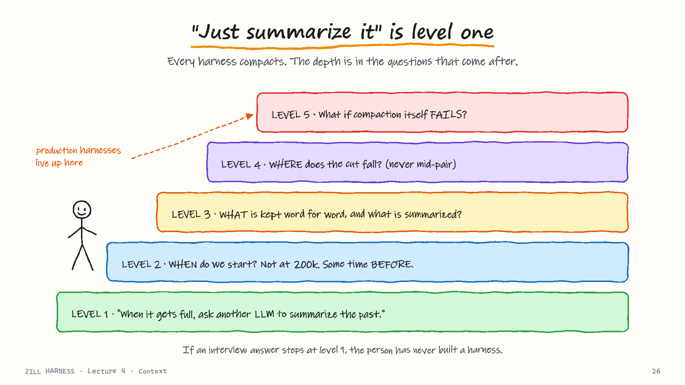
*Picture 26*

[ASK, wait 3 sec] If you were building your own harness, how would you do compaction? Pause the video and really think about it.

Most people say something like this. "If my model has a context window of two hundred thousand tokens, when it gets close to that, I'll just use another LLM to summarize the past context." Some people say a sliding window. Some people say, throw away the old tool results. These are good thoughts.

But here's the truth. If you go for an interview for an AI engineer role, and someone asks you how context compaction is done, and you only say "use another LLM to summarize the past", it tells them you have no idea how harnesses are built. Especially production harnesses. That answer is not wrong. It's just level one. And there are many more levels of depth.

Level two. When do you start compacting? If the context window is two hundred thousand tokens, you clearly cannot start when your messages reach two hundred thousand. You have to begin some time before. But exactly when?

Level three. What about past messages and new messages? Are you going to compact everything in the same way? Some people will say, keep the new messages and summarize the past. Okay, but how many new messages do you keep? And how do you summarize the past?

Level four. Even if you decide to summarize the past, where does the summarization boundary fall? Remember, the messages array is user, assistant, tool call, tool result, user, assistant, tool call. What if the boundary falls right between a tool call and its result? Then the fresh part starts with a tool result, and you have no idea what question was asked to get that result, because the question got summarized. So the boundary of splitting is very important.

And level five. What if compaction itself fails?

Production harnesses answer all five levels. So now let's uncover how deep modern harnesses actually go.

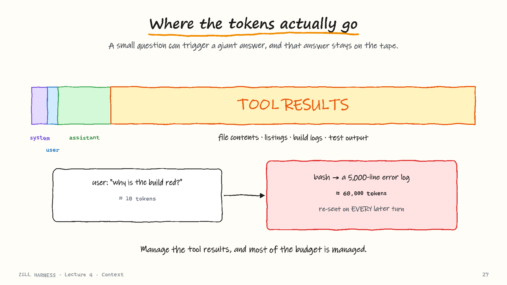
*Picture 27*

Okay, before we jump into Pi, I want to show you one small thing. Because once you see this, a lot of what Hermes does later will just make sense.

[ASK, wait 3 sec] Tell me honestly, what do you think takes up the most space in the context? Is it the system prompt? Is it what you type? Or is it what the model says?

Most people guess the system prompt, or the conversation. But look at this bar.

See this tiny purple bit at the start? That's the system prompt. This thin blue line next to it, that's everything you typed. And this small green part is what the model replied. And then look at this huge yellow block. That's the tool results. All the files the agent read, the folder listings, the build logs, the test output.

Let me give you a real example. Look at the boxes below. You type something very small, like "why is my build red?" That's maybe ten tokens. Now the agent goes and runs a bash command to check, and what comes back? A five-thousand-line error log. That can easily be sixty thousand tokens.

And here's the painful part, right? That log doesn't go away. It sits on the tape. And on every next turn, the whole tape is sent again. So you're paying for that same giant log again, and again, and again.

I see this in almost every agent I build. The context doesn't get full because of what we say. It gets full because of what the agent sees.

So just keep one line in your head: if you control the tool results, you control most of your budget. Remember this, because Hermes uses exactly this idea, and we'll come back to it.

---

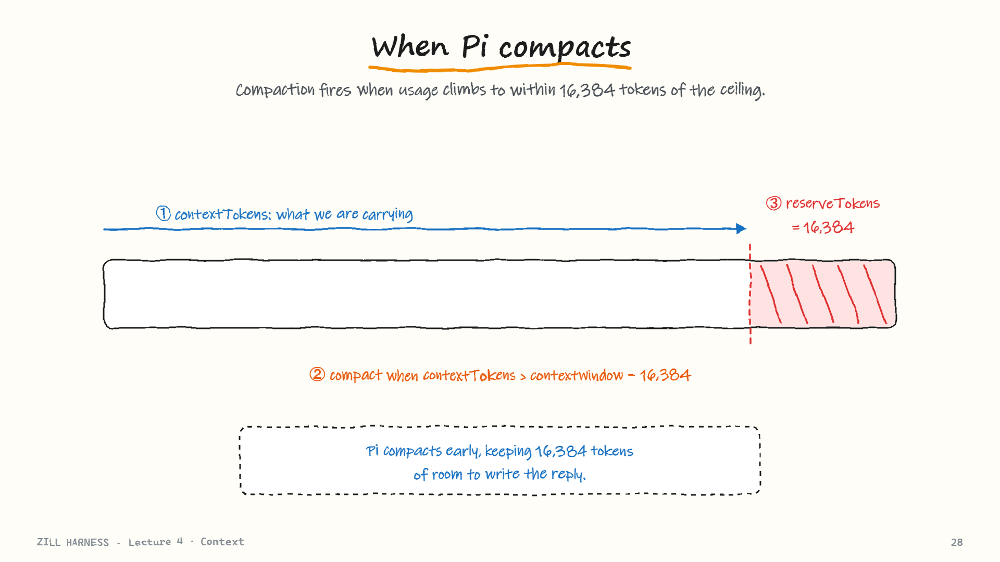
*Picture 28*

Alright, now let's open up Pi. And the first question is simple. When does Pi decide, okay, now I need to compact?

Look at this long bar. Think of it as the full context window. And this blue arrow on top, that's how much we're carrying right now. Every turn, this arrow gets a little longer.

Now see this red striped bit at the very end? Pi never lets you go into that area. It keeps it free on purpose. They call it reserveTokens, and by default it's sixteen thousand three hundred eighty-four tokens.

So Pi doesn't wait for the window to be completely full. The moment the blue arrow touches this red area, Pi says, okay, time to compact.

[ASK, wait 3 sec] Why do you think Pi keeps this space empty? Why not just use the full window?

Because think about it. When compaction kicks in, the model still has to answer you on that same turn. If the window is already completely full, where will it write the answer? So Pi keeps some room aside, just so the model can still reply.

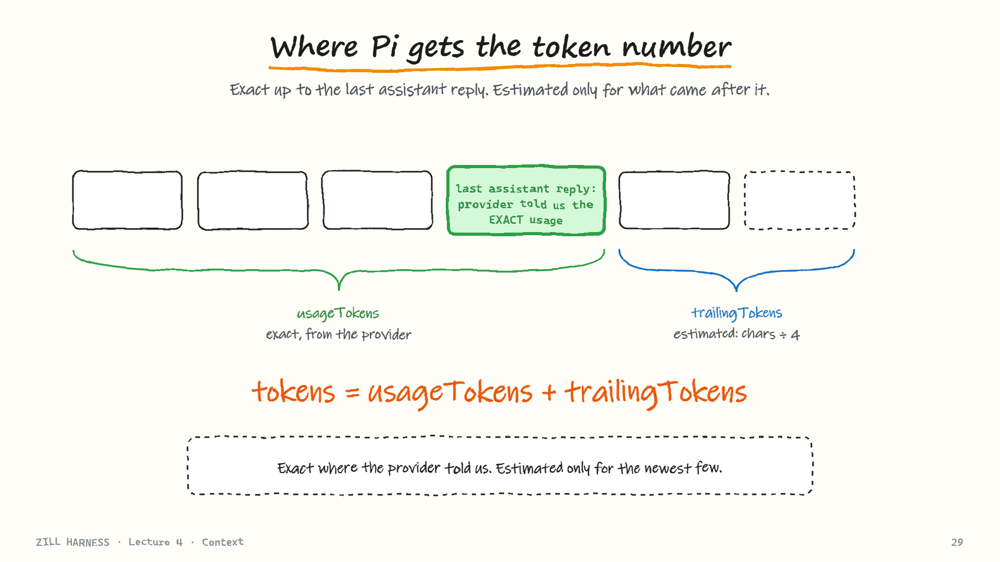
*Picture 29*

Okay, but here's something nobody really thinks about. To know when we touch that red area, we need to know how many tokens we have. So how do you actually count them?

[ASK, wait 3 sec] If you were building this, how would you count the tokens in your context?

The nice thing is, the model already tells us. Every time the model replies, the API sends back a small usage block. It says, this call used exactly this many tokens.

So look at this green box. That's the last reply from the model, and for that one we have the exact number. Pi calls everything up to here usageTokens. Exact, straight from the provider.

But see these boxes after it? A tool result came in, maybe you typed something new. The provider hasn't counted those yet. So Pi just estimates them. Those are trailingTokens.

And the total is simply both added together. Exact where we can, a guess only for the last few messages.

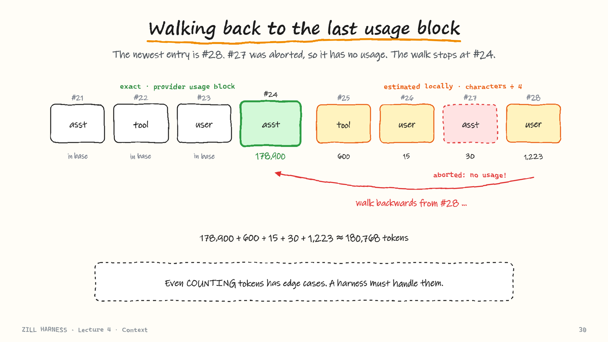
*Picture 30*

Now let me show you why even this is not so simple. This is a real kind of situation.

These are the last few messages of a session, number twenty-one to twenty-eight. Pi starts from the newest one, twenty-eight, and walks backwards, looking for the last reply that has a proper usage block.

Twenty-eight, that's a user message. Users don't have usage blocks, so keep going.

Now look at twenty-seven. It's red. This was a reply from the model, but the call broke halfway. Maybe the network dropped. So it never got a usage block either.

[ASK, wait 3 sec] So where does Pi finally find an exact number?

Number twenty-four. Right there, the provider told us exactly, one lakh seventy-eight thousand nine hundred tokens.

And everything after that, Pi estimates. Six hundred here, fifteen, thirty, twelve hundred and twenty-three. Add it all up, and you get roughly one lakh eighty thousand seven hundred.

See what I mean? You'd think counting tokens is the easy part. But even here, you have to handle a broken call, messages after it, all of that. That's what building a real harness looks like.

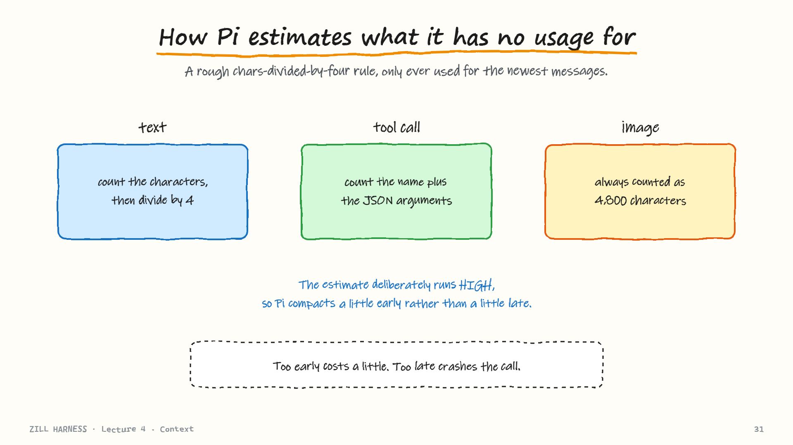
*Picture 31*

And how does Pi make that guess? Honestly, the rules are very simple.

For normal text, it just counts the characters and divides by four. Roughly four characters make one token.

For a tool call, it counts the tool's name plus the arguments.

And for an image, it doesn't even try to be clever. Every image is counted as four thousand eight hundred characters. Done.

And here's a smart little thing. These guesses are kept slightly on the higher side, on purpose. Because if Pi compacts a bit too early, no big deal. But if it compacts too late, the whole call fails. So it's better to guess high.

---

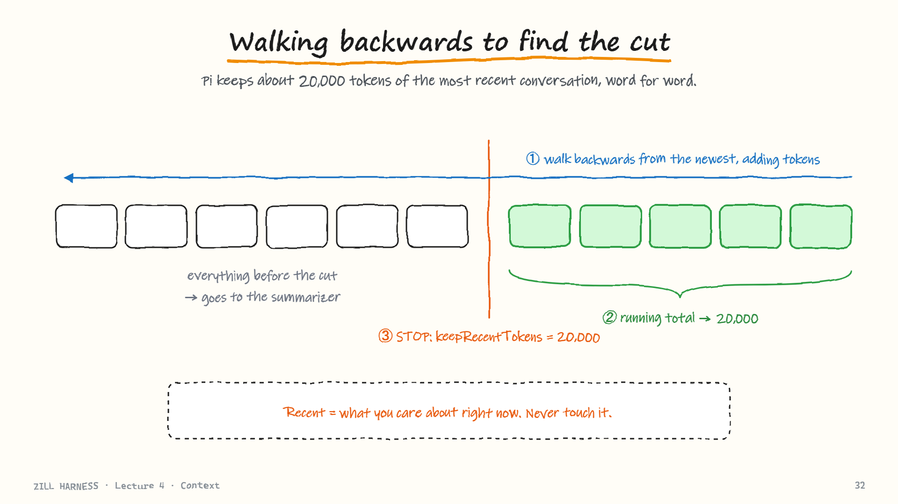
*Picture 32*

Okay, so Pi knows it has to compact. Now the real question. What do you actually throw into the summary, and what do you keep?

Look at this blue arrow going left. Pi starts from the newest message and walks backwards, adding up the tokens as it goes. And it keeps going until it has collected about twenty thousand tokens. That setting is called keepRecentTokens.

See this orange line? That's where it stops. That's the cut.

Everything on the right side, these green boxes, that's your recent work. Pi doesn't touch it at all. Word for word. Because that's what you're working on right now.

And everything on the left, these grey ones, the older stuff, that goes into the summary.

Simple, right? But wait, there's a catch.

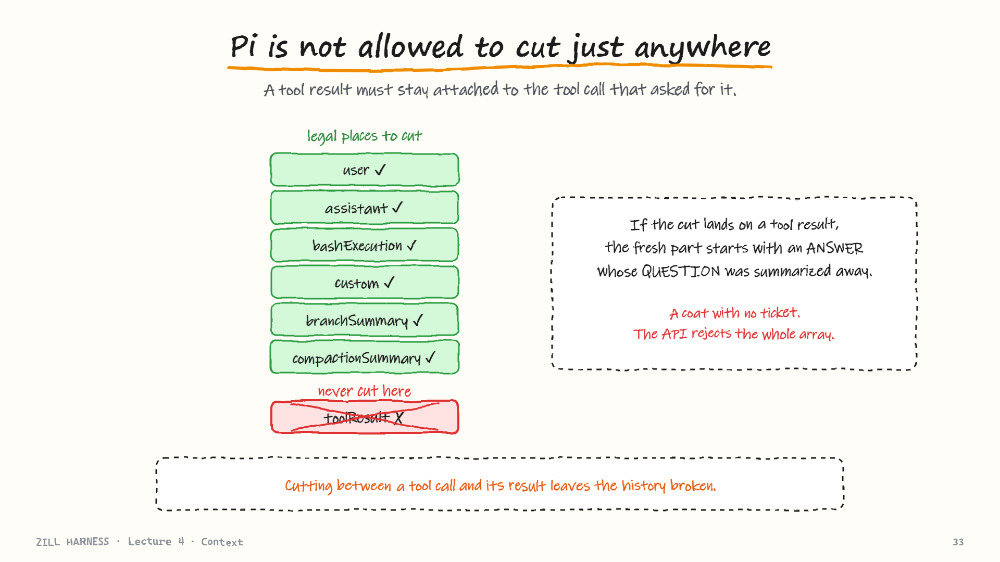
*Picture 33*

This part, I really want you to pay attention to. Because this is where you can see how much thought went into Pi.

[ASK, wait 3 sec] What do you think happens if that cut lands exactly on a tool result?

Think about it. Everything before the cut becomes a summary. So now your fresh context starts with a tool result. An answer. But the question, the tool call that asked for it, that's gone. It got summarized.

It's like walking into a cloakroom with a coat but no ticket. Nobody knows whose coat it is. And the API actually rejects the whole thing.

So Pi is very careful about where it cuts. Look at this green list. It's allowed to cut at a user message, because a fresh question starts there. It can cut at an assistant message. A bash execution, a custom entry, a branch summary, an old compaction summary, all fine.

But see this red one at the bottom? Tool result. Never. A tool result always has to stay glued to the call that asked for it.

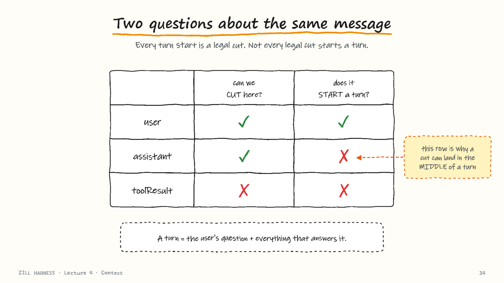
*Picture 34*

And there's one more small detail here, which I love.

Pi actually asks two different questions about every message. First, can I cut here? And second, does a new turn start here? A turn means one question from the user and everything that answers it.

Look at the user row. Can we cut? Yes. Does a turn start? Yes.

Tool result row. No and no.

But look at the assistant row. Can we cut? Yes. But does a turn start there? No.

And that little row is exactly why the cut can land right in the middle of a turn. The model's recent work is kept, but the question that started all of it is now on the old side.

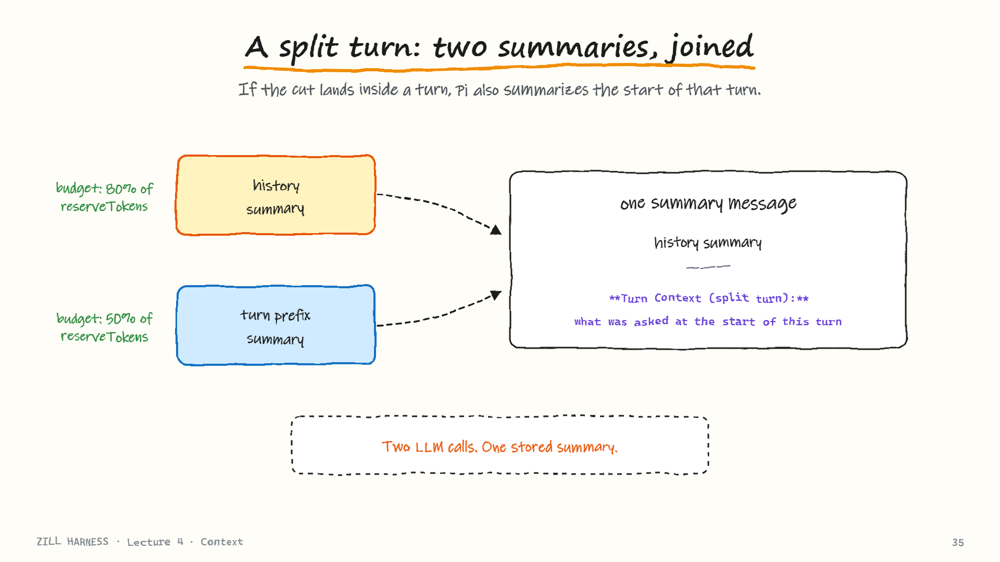
*Picture 35*

So what does Pi do in that case? It does something really neat.

It makes two summaries instead of one. Look at this yellow box. That's the normal summary of all the old history. It gets up to eighty percent of that reserve.

And this blue box, that's a small extra summary of just the start of this turn. Basically, what was the user asking? That gets up to fifty percent of the reserve.

Then both are stuck together into one single message. So yes, two calls to the model, but you store just one summary. And the model never forgets what question it was in the middle of answering.

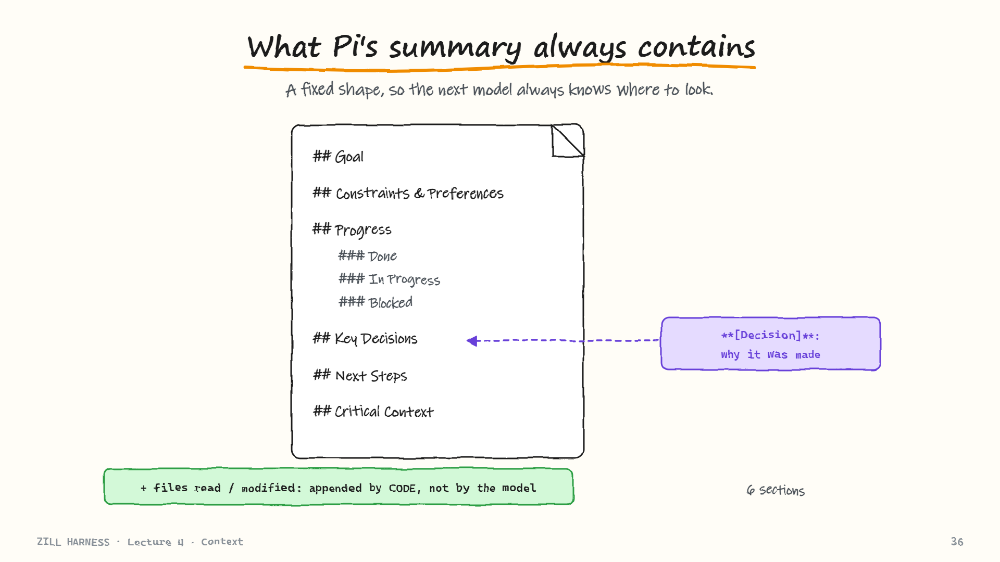
*Picture 36*

Now what does this summary actually look like? Because this matters for any harness you build.

Pi always uses the same shape. Look. The goal. The constraints and preferences. The progress, split into done, in progress, and blocked. The key decisions. The next steps. And critical context.

And see this purple note? For every decision, Pi also writes down why it was made. Because next time, the model needs the reason, not just the decision.

And this green line at the bottom, the list of files that were read and changed. That one is added by code, not by the model. So it's always correct.

Why always the same shape? So the next model knows exactly where to look for things. It doesn't have to search.

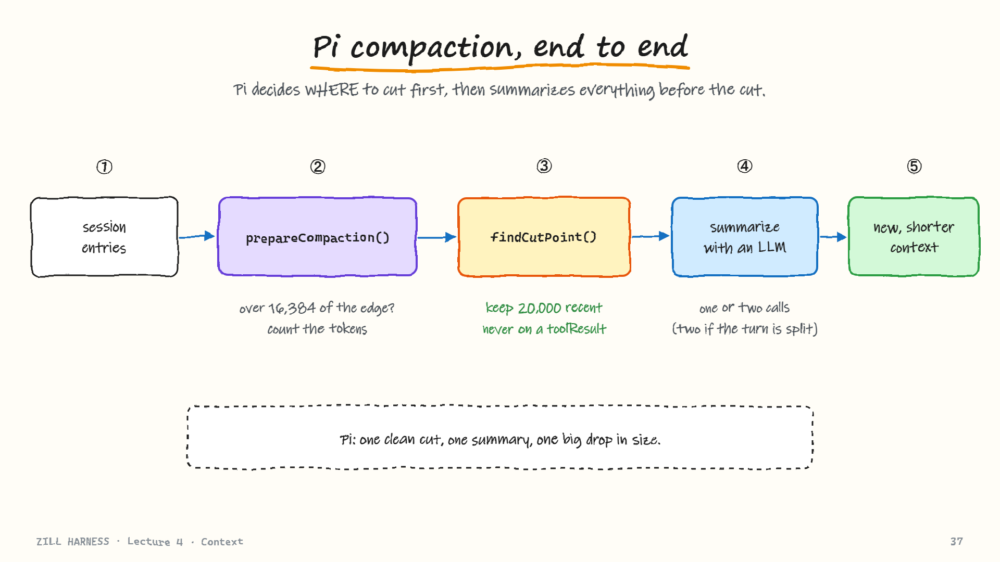
*Picture 37*

Okay, we've covered a lot of small pieces of Pi. So now let me put them all together, so you can see the full journey in one go. Just follow these five boxes with me, left to right.

Imagine you've been working with Pi for an hour. Lots of messages, lots of tool calls. That's this first box. All your session entries.

Now before every call, Pi quietly asks itself one question. "Am I getting close to the edge?" That's this second box, prepareCompaction. It takes the exact number from the last reply, guesses the rest, and checks: have we touched that red zone, the last sixteen thousand tokens? If no, nothing happens. Pi just carries on. But if yes, okay, now we compact.

Then the third box, findCutPoint. This is the careful part. Pi walks back from the newest message, collecting around twenty thousand tokens of your recent work. And wherever it stops, it checks: am I standing on a tool result? If yes, it moves. Because it never cuts there. Never leaves a coat without its ticket.

Fourth box. Now Pi takes everything before that cut and sends it to the model, and says, "summarize this for me". Usually that's one call. And if the cut landed in the middle of a turn, it's two calls, one for the old history and one for the start of this turn.

And the last box. You get back a fresh, short context. The summary at the top, your recent twenty thousand tokens right after it, exactly as they were. And Pi just continues working, like nothing happened.

So if I had to say Pi's whole idea in one line, it would be this. First decide where to cut, safely. Then summarize everything before that cut. One clean cut, one summary, one big drop.

And you know what's nice? None of this is secret. It's all sitting in one file in Pi's code, compaction.ts. Anyone can read it. It's just really hard to read, honestly. That's why I broke it down into these pictures for you.

---

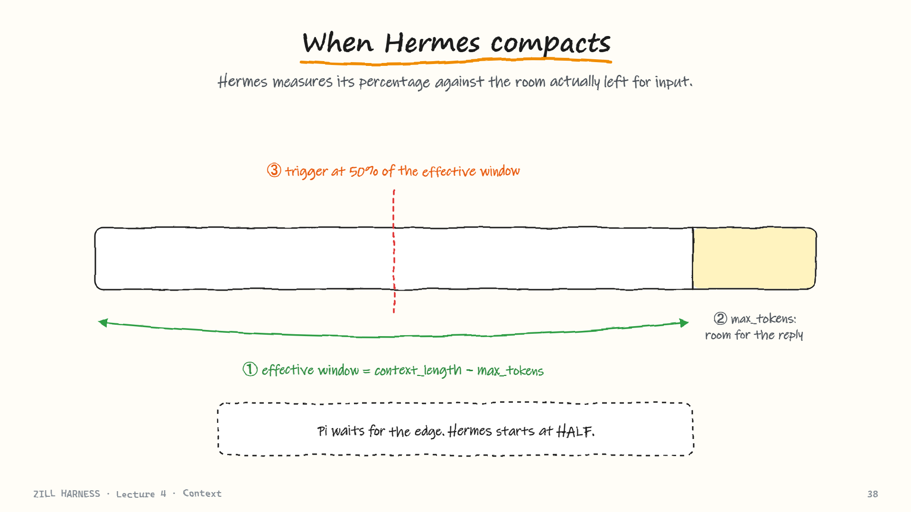
*Picture 38*

Now, if you thought Pi was detailed, wait till you see Hermes. Honestly, Hermes goes even deeper than Pi here, and it does almost everything differently.

So, same first question. When does Hermes compact?

Look at this green arrow at the bottom. Hermes first takes the full window and removes the space it needs for the reply. Whatever's left, they call it the effective window.

And now look at where this red dashed line is. Right in the middle. Hermes starts compacting at fifty percent of that window.

Half! Can you see how different that is? Pi waits until it's almost full. Hermes starts when it's only half full.

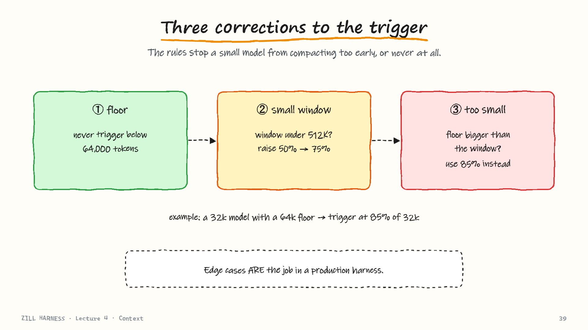
*Picture 39*

But it's not just a flat fifty percent. Hermes has three little rules on top of it, for tricky cases.

Look at the first box. A floor. Hermes will never compact below sixty-four thousand tokens. Otherwise, a small model would start compacting when half its window is still empty, which is a waste.

Second box. If the model's window is smaller than five hundred twelve thousand, Hermes pushes the trigger up from fifty to seventy-five percent.

And third box. What if the window is even smaller than that floor? Say the model only has thirty-two thousand tokens, but our floor is sixty-four thousand. That makes no sense. So in that case, Hermes just uses eighty-five percent of whatever window there is.

Now why am I telling you all these little numbers? Because this is the real work of building a harness. It's not the big idea. It's handling all these small cases so nothing breaks.

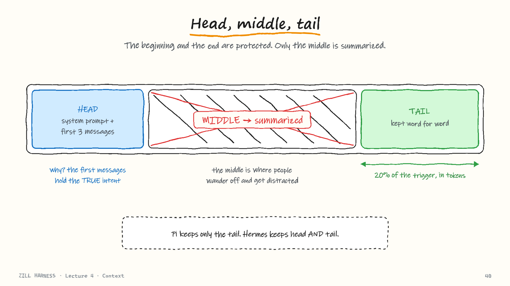
*Picture 40*

Okay, now the second big difference. What does Hermes keep?

Look at this blue box on the left. Hermes keeps the start of the conversation exactly as it is. The system prompt and the first three messages.

Look at the green box on the right. It also keeps the end, the most recent messages.

And this crossed-out part in the middle? That's the only thing that gets summarized.

[ASK, wait 3 sec] Why would you want to keep the first three messages? Pi doesn't do that.

Think about how you use an agent. When you start a session, you're fresh. Your first few messages are usually the clearest. That's where you say what you actually want. And then in the middle, you wander. You try something, you get distracted, you go down some side path.

So those first messages hold your real goal. That's why Hermes holds on to them. Pi only keeps the end. Hermes keeps both the start and the end.

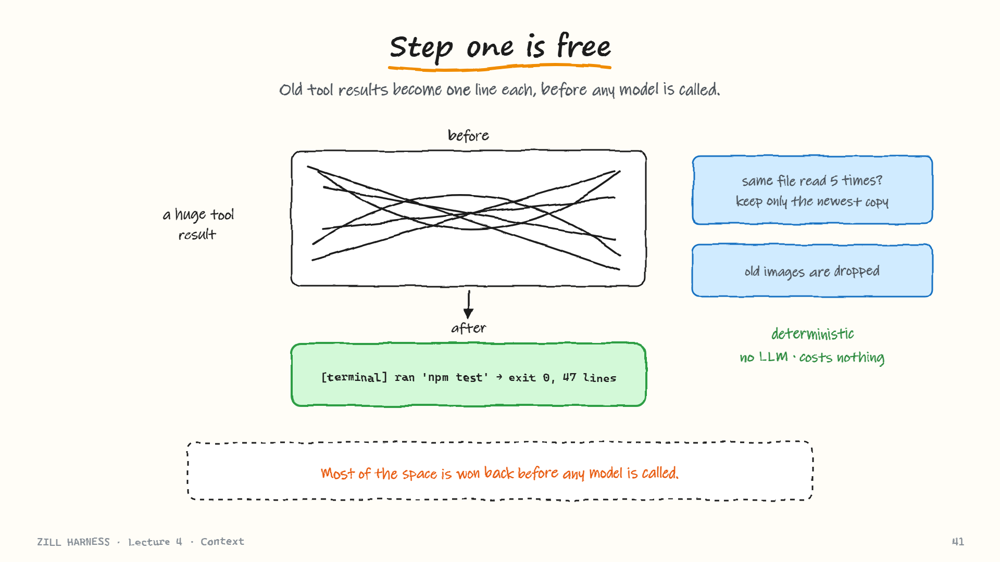
*Picture 41*

Now remember what I showed you in picture twenty-seven? Tool results take up most of the space. Here's where that comes back.

[ASK, wait 3 sec] What do you think Hermes does with all those old tool results?

Before Hermes summarizes anything, it first shrinks the old tool results. Look at this messy box on top. That's a huge tool result, maybe a giant test log. And look at what it becomes below. Just one short line. "Ran npm test, exit zero, forty-seven lines." That's all you really need to remember from it.

And look at these two notes on the side. If the agent read the same file five times, Hermes only keeps the latest copy. And old images are just dropped.

And here's the beautiful part. This step doesn't use the model at all. It's just plain code. It costs nothing. So most of the space is already freed up before Hermes even calls a model.

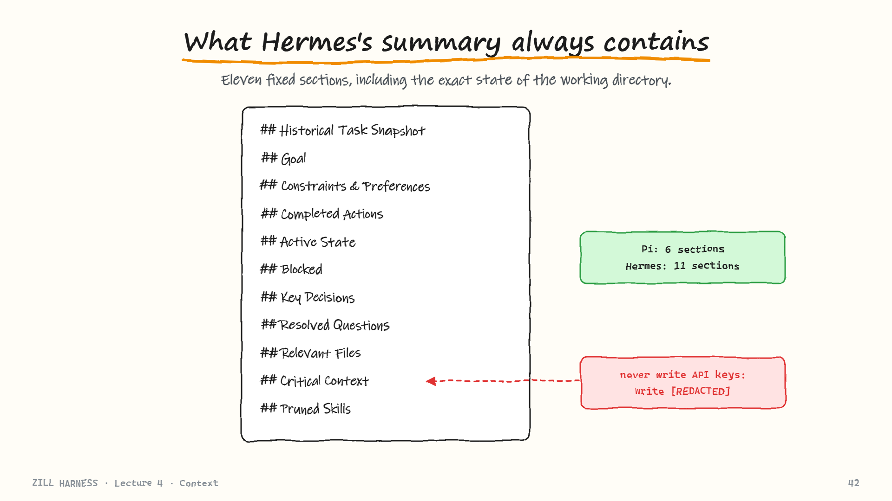
*Picture 42*

Now the summary. Remember, Pi had six sections. Hermes has eleven.

Let me just read them quickly. Historical task snapshot. Goal. Constraints and preferences. Completed actions. Active state. Blocked. Key decisions. Resolved questions. Relevant files. Critical context. And pruned skills.

So Hermes doesn't just remember what you decided. It also remembers exactly where the work is right now, and which files matter.

And look at this red note, I like this one. Never write an API key into the summary. Just write "REDACTED". Small thing, but it matters.

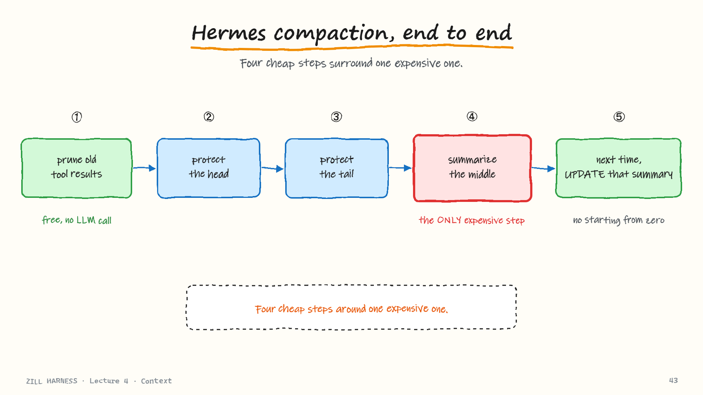
*Picture 43*

So, Hermes from start to finish. Look at these boxes.

First, shrink the old tool results. Free. Then keep the start. Then keep the end. Also free. Then summarize the middle, and that's the only step that actually costs you money. And the next time it compacts, it doesn't start from scratch. It just updates the summary it already has.

So four cheap steps around one expensive one. That's really clever design.

---

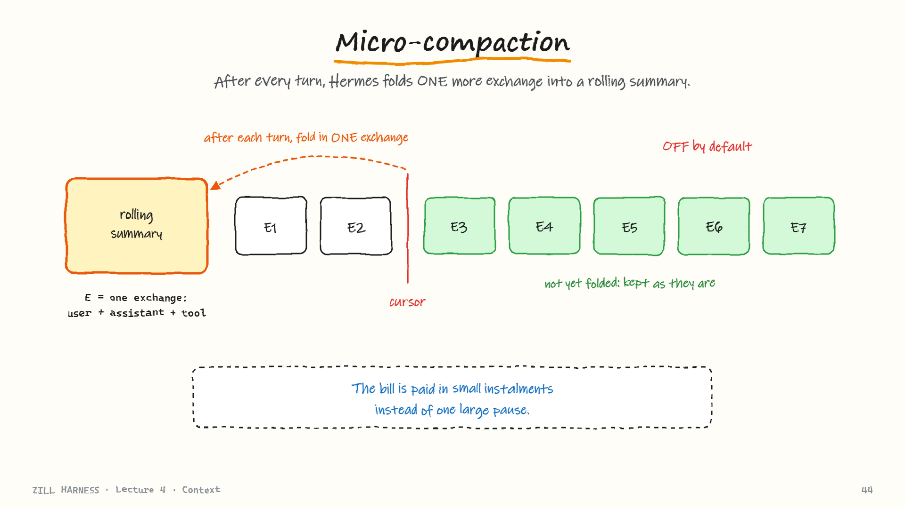
*Picture 44*

And Hermes still has one more trick. It's called micro-compaction, and honestly, this is my favourite part.

You saw how Pi works, right? It waits till the context is full, then summarizes everything at once. Big drop. Then it fills up again, and again a big drop.

Micro-compaction does it bit by bit instead. Look at this yellow box. That's a running summary. After every single turn, Hermes takes that one exchange, your message, the reply, the tool result, and folds it into this summary.

See E1 and E2? Already folded in. And this red line is like a bookmark. Everything after it, E3 to E7, is still kept as it is. After the next turn, the bookmark moves one step forward.

So when the window finally gets full, there's nothing big to do. The summary is already ready.

One thing to know though. In Hermes, this is switched off by default. You have to turn it on yourself.

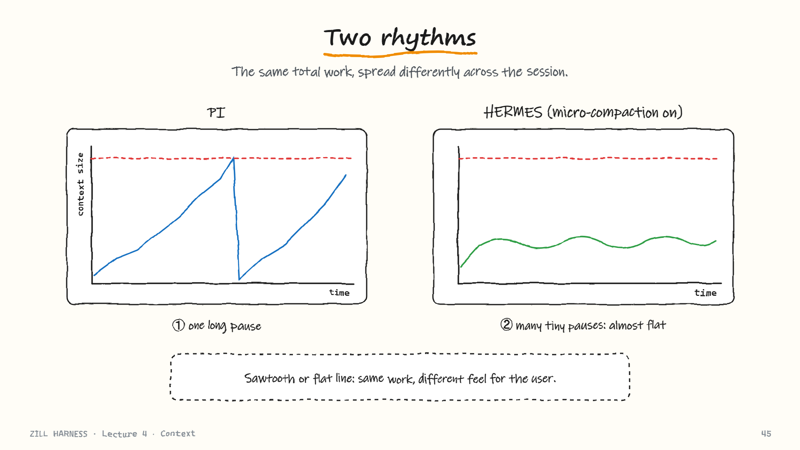
*Picture 45*

And you can actually see the difference if you draw it.

Look at the left one. That's Pi. The context goes up, up, up, then suddenly drops, then up again. Like the teeth of a saw.

And the right one, Hermes with micro-compaction. It stays almost flat. Lots of tiny steps instead of one big one.

Same amount of work in the end. Just spread out differently.

Now some of you might be thinking, wait, if the conversation keeps changing every turn, won't that mess up the cache? Good thinking. Yes, it does cost something there. We'll talk about the cache in a few minutes. I haven't seen this called out as a problem in Hermes, but I'd check it before depending on it.

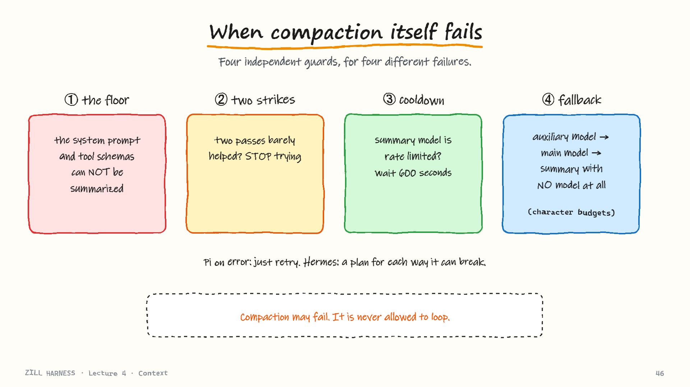
*Picture 46*

And now the last level of our ladder. What if compaction itself goes wrong?

Pi basically just tries again. But Hermes has really thought about this. Look, four separate guards.

First box, the floor. Some things can never be summarized, like the system prompt and the tool definitions. So if someone has a huge system prompt and a thousand tools, those alone might almost fill the window. Hermes is aware of that.

Second box, two strikes. If Hermes compacts once and it's still too big, it tries again. If after two tries it's still not helping, it just stops. It doesn't keep trying forever.

Third box, cooldown. To write a summary, you need a model. But what if that model says, sorry, too many requests right now? Then Hermes waits ten minutes and tries again.

And the last box, fallback. If the summary model isn't available, it tries a backup model. Then the main model. And if nothing works, maybe the API bill isn't paid, it still makes a basic summary using plain code, no model at all.

Because no matter what, compaction has to give you something back.

So compaction is allowed to fail. But it's never allowed to get stuck in a loop.

---

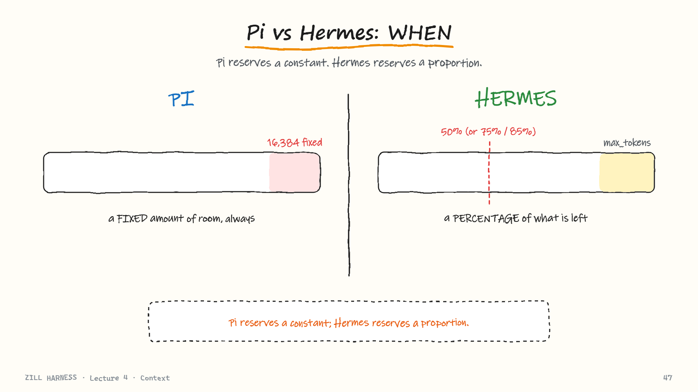
*Picture 47*

So let's put Pi and Hermes next to each other for a second.

When do they compact? Look at the left. Pi always keeps the same fixed space at the end. Sixteen thousand, every time.

Now the right. Hermes uses a percentage. Fifty, seventy-five or eighty-five, depending on the model.

So in short, Pi keeps a fixed amount. Hermes keeps a percentage.

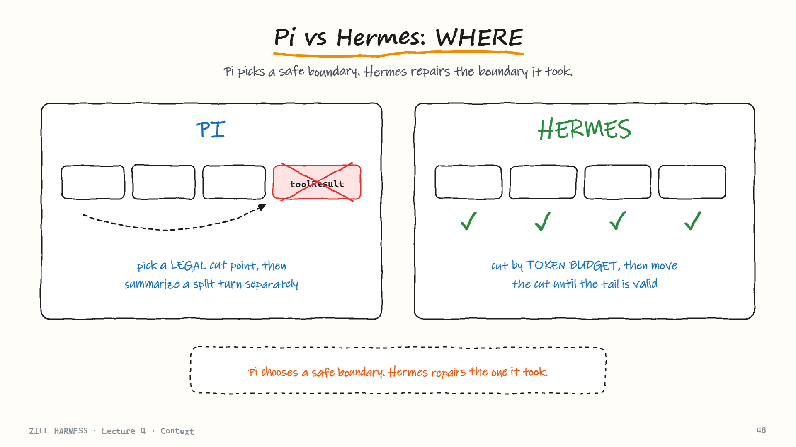
*Picture 48*

And where do they cut?

Look at Pi. It first finds a safe place, never on a tool result, and then cuts there.

Hermes does it the other way. It cuts by size first, and then moves the cut a bit until it's safe.

So Pi picks a safe spot before cutting. Hermes cuts, and then fixes it.

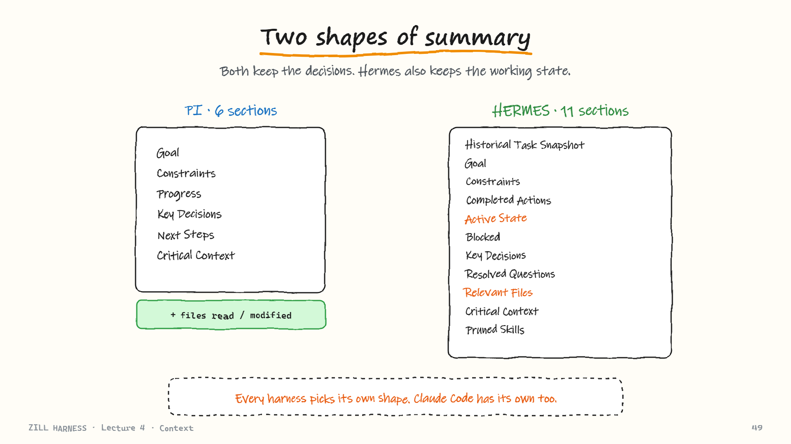
*Picture 49*

And the summaries. Pi has six sections, plus the list of files. Hermes has eleven.

Both remember the key decisions. But Hermes also remembers exactly where the work stands right now.

And honestly, every harness has its own shape for this. Even Claude Code has its own.

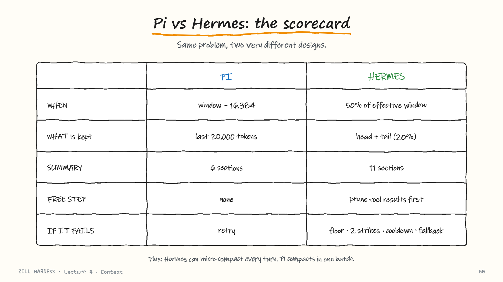
*Picture 50*

So here's everything in one table. Look at each row.

When: Pi waits till almost full, Hermes starts at half. What it keeps: Pi keeps the last twenty thousand tokens, Hermes keeps the start and the end. Summary: six sections against eleven. The free step: Pi doesn't have one, Hermes shrinks tool results first. And when things fail: Pi retries, Hermes has four separate guards. And on top of that, Hermes can do micro-compaction.

Same problem. Two completely different answers.

And I really think this is one of the big reasons Hermes became so popular. When you ship something to real users, they never see compaction happening. It just has to work. And Hermes clearly thought about every way it could break.

---

# PART 3 — DeepSeek Harness, and the cache


*Picture 51*

Now there's a third one I want to show you. DeepSeek also has an open-source harness. It's called DeepSeek Harness. And it thinks about compaction in a totally different way.

In Pi and Hermes, compaction is built into the harness. It's part of the main code.

Now look at this purple circle in the middle. That's DeepSeek's main loop, and they keep it small. And see this dashed box? That's just a socket. A slot. And compaction is something you plug into that slot from outside.

Look at the boxes on the left. This top one is the package that actually does the compaction. This middle one is optional, it shrinks big tool results first. Sounds familiar? That's the same idea as Hermes. And the bottom one just gives you a /compact command, so you can compact whenever you want.

So if you don't like how it summarizes, you just swap the plugin. You never touch the main loop.


*Picture 52*

And this next idea, I really like. In DeepSeek Harness, compaction never deletes anything.

Look at the top row. That's the session log. Every single thing that happens gets added to it. Nothing is ever removed. Even the compaction itself is written down in the log, see these purple boxes at the end? Start, summary, end. But the model never sees those.

Now look at the bottom row. That's what the model actually sees, and it's built from the log. When compaction happens, the old messages are just hidden behind one summary. This yellow box. And the recent messages stay as they are.

So the model sees a short version. But you still have everything. If you ever need the exact old text, it's right there in the log.


*Picture 53*

So when does DeepSeek Harness compact?

Look at this yellow box. It has two limits, and whichever one you hit first, that's when it compacts. One limit is eighty percent of the window. The other is the window, minus the space for the reply, minus an extra sixty-five thousand five hundred thirty-six tokens.

And this green box says, after compacting, keep the newest sixteen percent exactly as it is.

Now why two limits? Look at this table. Say you have a two-hundred-thousand-token model. Eighty percent is one lakh sixty thousand. But the other rule gives about one lakh two thousand. That's smaller, so that one wins.

Now take a huge one-million-token model. Eighty percent is eight lakh. The other rule gives about nine lakh. Now the eighty percent rule wins.

So with a small model, the fixed space matters more. With a big model, the percentage matters more. It's like Pi and Hermes, both ideas combined.


*Picture 54*

Now let's walk through how it actually does it.

Look at these two boxes on the left. There are two ways compaction starts. The blue one is the normal way. Before every call, it checks, are we getting too full? The red one is when things already went wrong. The model's API comes back and says, sorry, this is too long.

Either way, they go into the same pipeline.

First, this green box. If the shrinking plugin is installed, it shrinks the tool results. Free, no model.

Then it checks again. Does it fit now? If yes, look at this green arrow, it just stops there. No summary needed. That saves a whole model call.

If it still doesn't fit, it makes one summary call. And look at this small detail here. When it makes that call, it sends the same system prompt and tools again. Why? To keep the cache warm. I'll explain that in a minute.

And this red dashed line. If the API said "too long", it shrinks harder and tries only once more.

And if the summary fails completely? Look at the bottom. It doesn't crash. It just writes a warning and carries on.


*Picture 55*

And DeepSeek's summary also has a fixed shape. Eight sections this time.

Primary request and intent. Key technical concepts. Files and code. Errors and fixes. Pending jobs. Current work. Next step. Critical context.

And look at this blue box. The model is told: this is a checkpoint, just continue, don't talk about it. Otherwise the model might stop and say "thanks for the summary!", which we don't want.

And these two boxes. It only keeps the summary text, no reasoning, no tool calls. And it's honest about its limits. It can't shrink the system prompt, the tools, or one single giant tool call.

So Pi has six, Hermes has eleven, DeepSeek has eight.


*Picture 56*

So here are all three together. Just look across each row.

When, what they keep, the free step, the summary, and what happens on failure. Three harnesses, the same five questions, and three completely different answers.

And that's the point. There's no one right answer. It's all trade-offs. You pick what matters for your product.


*Picture 57*

One small extra thing about DeepSeek. Context management isn't only in the harness. It's also in how the model itself was trained.

In the DeepSeek V3.2 paper, they explain how the model handles its own thinking while using tools. Look at this row. While tool results keep coming in, the model keeps all its thinking. It can reason across many tool calls.

But see this red line? The moment you, the user, send a new message, the old thinking is thrown away. The tool calls and results stay, only the old reasoning goes.

And for their search agents, they tried something really simple when the context gets full. Look at this box on the right. Just throw away all the old tool history and keep only the original question. And surprisingly, simple tricks like that worked really well.

---


*Picture 58*

Okay, I keep saying the word "cache". So let's actually talk about it. Prompt caching. Not many people talk about this, but it saves a lot of money.

Think about what our loop does. Every single turn, we send everything again. The system prompt, all the tools, all the old messages. Just to add one new message at the end and ask, "okay, what next?"

Look at these three rows. Call one, everything is new. Call two, look, this green part is the same as before. Call three, the green part is even longer.

The model itself remembers nothing. But the provider can. It can save the work it already did for that same starting part. That's the cache. And this red mark is where you tell it, "cache up to here". It's called cache_control.

So why does this save money? If you've done any inference, you'll know there are two steps. Prefill and decode. In prefill, the model does a lot of heavy work on every input token. It computes these key and value vectors. But for the green part, that work is already done and saved. So it skips it.

Look at these boxes at the bottom. You pay less. And the answer starts faster. There's a name for that, time to first token, TTFT.

And one more word, TTL. Time to live. That's just how long the provider keeps this cache. Maybe five minutes, maybe an hour. Pi, for example, supports the one-hour option.


*Picture 59*

So now let's connect this back to compaction.

[ASK, wait 3 sec] What do you think happens to the cache when we compact?

Look at the top row. Before compaction, the system prompt and tools are cached. The long history is cached. Only the new message is fresh.

Now look at the bottom row. After compaction, the system prompt and tools are still cached, because they didn't change. But this red part? The summary is brand new. And the recent messages moved, so they have to be worked out again.

So every time you compact, you lose the cache once.

That gives us two simple rules. Look at the boxes below. One, keep your system prompt and tools the same, and always at the start. Then they stay cached no matter how often you compact. And that's exactly why DeepSeek sends them again in its summary call.

Two, if you compact every single turn, like micro-compaction, you lose the cache every single turn. That's the price of that flat line.

---

# PART 4 — Build compaction into Zill


*Picture 60*

Okay. We've seen how the best harnesses in the world do this. Now it's our turn.

Pi and Hermes have thousands of lines just for this. A lot of that is to support many different models. But Zill is our small harness. So we'll keep just the main idea.

Look at these green boxes on the right. When the tape gets too big, we keep the last six messages exactly as they are. Six. We call that KEEP_RECENT.

And look at the grey boxes. Everything older than that, we send to the model once, and ask it to write one summary. That's this yellow box.

So our new tape is just one summary, plus the last six messages. That's it.

To count tokens, we use Pi's simple trick. Characters divided by four.

And we borrow three small ideas from what we saw today. Look inside the yellow box. First, from Hermes, we always copy your original request word for word into the summary. So no matter how many times we compact, your real goal is never lost. Second, also from Hermes, we cut big tool results short before sending them to the summary. And third, like Pi and Hermes, our summary always has the same sections. Goal, progress, decisions, files, errors, next steps.


*Picture 61*

But our simple version has the same problem we saw in Pi.

[ASK, wait 3 sec] Look at the left side. Can you see the problem?

Look at this orange line. That's our cut. And it falls right between "write four.txt", the call, and "Wrote four.txt", the result.

Now look at the right side. After compaction, the first thing we keep is that result. But its call is gone. It got summarized. That's an orphan. The coat without a ticket. And the API will reject it.

The fix is literally one line. Look at this green box. If the kept part starts with a tool result, just drop it.

And see, we don't make up a fake call to match it. That would be lying to the agent about what happened. We just drop it. It's safe, because the summary already says what happened there.

It's the same idea as Pi's rule, never cut on a tool result. We just do it the cheap way.


*Picture 63*

So this is everything we're building today.

Look at this big yellow box. One new file, context.py. Inside it, a few small functions. One to count tokens. One to turn old messages into plain text. One that does the actual compaction. One that fixes that orphan problem. And one backup that writes a simple summary without any model, just like Hermes does, in case the model is down.

This blue box. One small change in the loop. We add a hook called before_turn. Before every call to the model, the loop gives the messages to this function, and uses whatever comes back. That's how compaction plugs in. A bit like DeepSeek, our loop doesn't even need to know compaction exists.

And these two boxes. Some tests with a fake model, so they run without internet. And a demo with a tiny budget, only fifteen hundred tokens. Way too small on purpose, so we can actually see compaction happen live.

---

Alright, let's build it. Open Claude Code in your Zill folder, and paste this prompt.

> **Do:** paste the prompt below into Claude Code. It's also saved as `zill-lecture4-build-prompt.md`.
```text
You are building the next part of Zill (lecture 4 of the series): context
management, meaning the compaction fold that keeps the message array under a
token budget. The parts are cumulative. Your repo already contains the package
zill/ with provider.py (complete(model, system, messages, tools) returns
{"text", "tool_calls", "usage": {"input", "output"}} and uses the neutral
message format {"role": "user"|"assistant"|"tool", "text", ...}), loop.py
(run_loop with the on_event and before_tool sockets), tools.py, operations.py,
security.py, plus demos/ and tests/ from lectures 2 and 3.

Today adds ONE new file, zill/context.py, and ONE small socket in loop.py.
Build exactly what this spec describes and nothing else.

GROUND RULES
- Python 3.10+, standard library only, no third-party packages.
- Must run on Windows, macOS and Linux.
- Same code standard as before: a module docstring on every file naming the
  concept it teaches and the design rules it embodies; a docstring on every
  public function; a short comment wherever behaviour is subtle (the seam,
  the fallback, the "never loop" rule).
- Size targets including documentation, within about 15%: context.py 120
  lines, the loop.py change 10 lines or fewer, tests 140, demo 70.
- Commit after each milestone: loop socket, context.py, tests, demo.
- Do not add features beyond this spec. Where the spec is ambiguous, pick the
  simpler option and note it in a one-line comment at the top of the file.
- Read provider.py and loop.py before you start, and match their names and
  message shapes exactly. If anything below contradicts them, stop and report
  it instead of guessing.

THE ONE IDEA TO PRESERVE
One fold, two halves. When the tape (the message array) is over budget, the
OLD half is folded into one model-written summary message, and the RECENT half
(the last KEEP_RECENT messages) is kept word for word. Summarize the past,
keep the present sharp. The system prompt and the tool definitions are never
part of the fold. They are not in the messages list at all.

------------------------------------------------------------------------------
1) zill/loop.py: the only change allowed to an existing file
------------------------------------------------------------------------------
- Add a keyword parameter before_turn=None to run_loop.
- At the start of every turn, BEFORE provider.complete is called:
    if before_turn is set: messages[:] = before_turn(messages)
  Replace the list IN PLACE, so the caller's list shows the fold too.
- If before_turn raises, report it through on_event (or print one line) and
  continue the turn with the unchanged messages. A broken compactor must never
  kill the run.
- Nothing else in loop.py changes. All existing tests must still pass.

------------------------------------------------------------------------------
2) zill/context.py: the fold
------------------------------------------------------------------------------
Constants
  CHARS_PER_TOKEN = 4       # a budget meter, not a tokenizer
  KEEP_RECENT     = 6       # never summarize the freshest messages
  CLIP_CHARS      = 600     # per message, in the transcript we summarize
  CLIP_TOOL_CHARS = 300     # tool results are clipped harder: they are the bulk
  MARKER          = "[Conversation so far, compacted]"
  SUMMARY_INSTRUCTION = a system prompt for the summarizer that says:
    You compress agent transcripts into a handover note. Use exactly these
    headings: Goal; Constraints and preferences; Progress (done / in progress /
    blocked); Key decisions and why; Files created or edited and their purpose;
    Unresolved errors; Next steps. Be dense and factual, and stay under 250
    words, because the summary itself rides on every later call. Never copy
    secrets such as API keys or passwords: write [REDACTED].

estimate_tokens(messages) -> int
  Sum of len(str(m)) over the list, integer-divided by CHARS_PER_TOKEN.
  The docstring says plainly that this is a rough estimate, which is enough
  because we fold long before the hard ceiling.

render(messages) -> str
  A plain-text transcript, one block per message:
    [role]                   for user and assistant messages
    [tool: <name>]           for tool messages
  followed by the text clipped to CLIP_CHARS (CLIP_TOOL_CHARS for tool
  messages), with " …[clipped N chars]" when something was cut. For an
  assistant message, add one line per tool call: "-> called <name>(<args>)"
  with the arguments clipped to 120 chars. A message whose text starts with
  MARKER (an earlier summary) is kept up to 4,000 chars, because an earlier
  summary must survive into the next one.

original_request(messages) -> str | None
  The text of the first user message that does not start with MARKER. If the
  first message IS an earlier summary, return the text after its
  "Original request (verbatim):" line instead, so the original request
  survives any number of folds.

compact(model, messages, budget_tokens, complete=None, on_compact=None) -> list
  - complete defaults to provider.complete. It is injectable so that the tests
    need no network.
  - If estimate_tokens(messages) <= budget_tokens, or len(messages) <=
    KEEP_RECENT + 1: return messages unchanged (the same object).
  - old, kept = messages[:-KEEP_RECENT], messages[-KEEP_RECENT:]
  - kept = _mend(kept)                     # see THE SEAM below
  - summary = ONE call to complete(model, SUMMARY_INSTRUCTION,
      [{"role": "user", "text": "Summarize this transcript:\n\n" + render(old)}],
      <no tools: pass the empty value that provider.complete accepts>)["text"]
  - If that call raises or returns empty text, do not crash. Use
    _fallback_summary(old) instead, and start it with
    "(fallback summary: the summarizer was unavailable)".
  - head = MARKER + "\nOriginal request (verbatim): " + original_request(messages)
    (clipped to 2,000 chars, omitted if None) + "\n\n" + summary
  - Roles must still alternate correctly. If kept[0] is a user message, merge
    head into it: {"role": "user", "text": head + "\n\n---\n\n" + kept[0]["text"]}.
    If kept is empty after mending, return [{"role": "user", "text": head}].
    Otherwise return [{"role": "user", "text": head}] + kept.
  - Return a NEW list. Never mutate the input list or its message dicts.
  - If the result is STILL over budget, return it anyway. One fold per call,
    never a retry loop. (Hermes' lesson: compaction may fail, it may never
    loop.) The next turn can fold again.
  - If on_compact is given, call on_compact(tokens_before, tokens_after, head)
    after a fold, so a demo can show it.

THE SEAM: _mend(kept) -> list
  The cut before the last KEEP_RECENT messages does not know about call and
  result pairs. If it lands between a tool call and its result, the kept slice
  starts with an ORPHAN tool result whose call was summarized away, and the
  API rejects the whole array. Drop leading messages whose role is "tool"
  until the slice starts on a legal message. Never invent a fake call to match
  an orphan: its meaning is already in the summary. If provider.py pairs
  results with calls by an id, also drop any tool message in kept whose id has
  no matching call in kept.

_fallback_summary(old) -> str
  A deterministic summary with no model at all (Hermes' last resort): the
  tool names used with counts, the paths passed to write_file / edit_file, the
  last three tool results that contain "ERROR" (each clipped to 200 chars),
  and the last assistant text (clipped to 500 chars). Clip the whole thing to
  3,000 chars.

Wiring: the caller passes
  before_turn=lambda msgs: compact(model, msgs, budget_tokens)
to run_loop. Nothing else needs to know that compaction exists.

------------------------------------------------------------------------------
3) demos/context_demo.py: watch the fold happen
------------------------------------------------------------------------------
- Budget from argv, default 1500 tokens (absurdly small on purpose). If that
  default produces no fold with this provider, lower it until it does, and
  report the value you chose.
- Reuse the tools and permission setup from demos/build_demo.py (lecture 3),
  in a fresh temporary folder, so that the demo runs unattended.
- before_turn wraps compact: before each model call it prints
  "turn N: sending X tokens". When a fold happens, it prints
  "*** compacted: X -> Y tokens ***" and the first 600 chars of the head.
- Task: "Create five files one.txt through five.txt, each with 20 lines of the
  word ping, one write_file at a time with a read_file check after each; then
  write MANIFEST.md listing each file and its line count, verified by counting
  the lines (wc -l, or a Python one-liner on Windows)."
- After the run, check from Python that all five files have 20 lines and that
  MANIFEST.md names all five. Print PASS or FAIL, and the number of folds.
  With the default budget, zero folds also means FAIL.

------------------------------------------------------------------------------
4) tests/test_zill_context.py: stdlib unittest, fake complete, no network
------------------------------------------------------------------------------
a) estimate_tokens: a message of about 400 chars gives about 100 tokens.
b) Under budget: compact returns the very same object.
c) KEEP_RECENT + 1 messages, over budget: returned unchanged.
d) Over budget: the result starts with MARKER, ends with the last kept
   messages unchanged, has at most 1 + KEEP_RECENT messages, and the input
   list is not mutated.
e) The seam: when the kept slice would start with a tool message, that message
   is dropped; when every kept message is a tool message, the result is the
   head message alone.
f) Original request: after TWO folds (fold, append more messages, fold again)
   the first user request is still present word for word.
g) A summarizer that raises: the fallback is used, no exception escapes, and
   the result is shorter than the input.
h) A 50,000-char tool result appears clipped in the transcript sent to the
   summarizer (the fake complete records what it receives).
i) Alternation: when the kept slice starts with a user message, the head is
   merged into it and no two user messages are adjacent.
j) The loop socket: run_loop with a fake provider calls before_turn once per
   turn, replaces the list in place, and survives a before_turn that raises.

------------------------------------------------------------------------------
VERIFY BEFORE FINISHING: report each one honestly, with the output
------------------------------------------------------------------------------
(a) All tests pass, including the lecture 2 and 3 tests.
(b) demos/context_demo.py with the default budget of 1500 folds at least once
    and prints PASS.
(c) The same demo with budget 100000 never folds and also prints PASS.
(d) Paste one real summary head that the demo produced.
(e) git log shows today's commits.
If something cannot be verified (for example, no API key), say so plainly
instead of claiming success.
```

While this is running, let me quickly show you a few things in this prompt.

First, right at the top. It says, today we add one file and one hook, nothing else. I always keep these changes small. Because then I can actually read and check every line it writes.

Second, look at these rules. "Never change the original list." And this one: "If it's still too big after compacting, return it anyway. Never loop." That's straight from Hermes. Compaction can fail, but it must never get stuck.

Third, see this line? "Keep the summary under two hundred fifty words." Why? Because the summary goes along with every call after this. If the summary itself is huge, we're wasting the very space we wanted to save.

And at the end, I tell it exactly what "done" means. The tests pass. The demo actually compacts and prints PASS. With a big budget, it doesn't compact and still passes. And if it can't check something, it has to tell me honestly, not pretend.


*Picture 62*

Okay, it's done. Let's run the demo.

> **Do:** run `python demos/context_demo.py` in the terminal.
Watch this number. A few hundred tokens. It's growing. Nine hundred. Thirteen hundred. Sixteen hundred...

And there! "Compacted." See how it dropped? That's Zill writing a summary of its own work, right now, in front of us.

And look, it just keeps going. Four.txt, five.txt, the manifest file. And at the end, PASS. The task didn't even notice that its history got squeezed.

This is exactly the saw shape from this picture. Up, drop, up, drop.

> **Do:** scroll up to the summary it printed.
Let's read what Zill wrote about itself. "Original request, word for word." There's the whole task. Then the files it made so far. The decisions. And what's still left to do. It's basically a handover note, like you'd write for a colleague.

> **Do:** run `python demos/context_demo.py 100000` in the terminal.
Now same demo, but with a big budget. Look, it never compacts, and it still passes.

So compaction doesn't change what the agent does. It just lets it keep working long after it would have run out of space.

---


*Picture 64*

So, if there's one thing I want you to take home from today, it's this.

Knowing what goes into the context is just the beginning. If you build your own harness, compaction really comes down to three questions.

Look at this first box. When do I compact? A fixed space like Pi, a percentage like Hermes, or both like DeepSeek?

The second box. How do I compact? What do I keep exactly? Where do I cut? What can I shrink for free?

The third box. What does my summary look like? What must always be in it?

And this red one at the bottom, if you're going to put it in front of real users. What happens when compaction itself fails?

Okay, now a small homework. Three things.

One. Run the demo with a small budget and actually read the summary Zill writes. Find one thing it forgot that you think was important. Then change the summary instruction so it doesn't forget it next time.

Two. Play with the numbers. Change KEEP_RECENT from six to two, then to twelve. Change the budget. Watch how often it compacts, and if the task still passes. You'll really feel everything we talked about today.

And three. Pi and Hermes aren't the only ones. Codex does it in its own way too, and it's all public. Go look at it, and ask the same questions. When, how, what, and what if it fails.

Thank you so much for watching. I'll see you in the next lecture.

---

## Notes for you (not spoken)

- **Before recording, run the build prompt once in Claude Code**, so the demo you show on camera is real.
- **If the video is too long:** skip Step 57, the cache question in Step 45, and Steps 20–21. Or split into two videos after Step 25.
- **Check these numbers against the current code before recording:** Pi (16,384 reserve, 20,000 kept, 4,800 image estimate, split-turn budgets 80% / 50%), Hermes (50%, 64k floor, 512K → 75%, 85%, first 3 messages, 20% tail, 600-second cooldown, 11 sections, micro-compaction off by default), DeepSeek Harness (80%, 65,536 headroom, 16% kept, retry once, 8 sections) from the `dsh-compaction-basic` README. "Pi supports the one-hour TTL" is from your transcript.
- Older versions are saved as `zill-lecture4-script-old.md`, `zill-lecture4-script-v2.md` and `zill-lecture4-script-v3-short.md`.
