# Lecture 6 — Harness, fleet and client

> **The question:** Zill is ten working files that do not know each other exist. How do you turn them into one agent, run many agents at once, and give people a way to start it?

This is the last lecture, and it is mostly plumbing. None of the three new files introduces a hard idea; the hard ideas were lectures 2 to 5. What these files do is turn a pile of tested parts into a tool you can actually use. By the end Zill is finished.

## Where we start

Before today the repo holds ten files: `provider.py` and `loop.py` (lecture 2), `tools.py`, `security.py` and `operations.py` (lecture 3), `context.py` (lecture 4), and `memory.py`, `skills.py`, `session.py` and `subagent.py` (lecture 5). Each works and is tested on its own, but nothing ties them together. There is no single object you can point at and call "the agent".

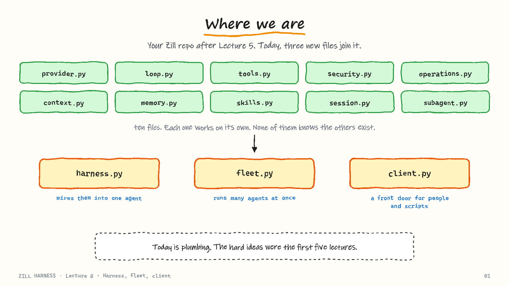
***Where we are.** Your Zill repo after Lecture 5. Today, three new files join it.*

Three files join the repo today:

| File | Question it answers |
|------|---------------------|
| `harness.py` | Where do the ten files meet? |
| `fleet.py` | How do you run twenty-five projects at once? |
| `client.py` | How does a person, a script or a website start the agent? |

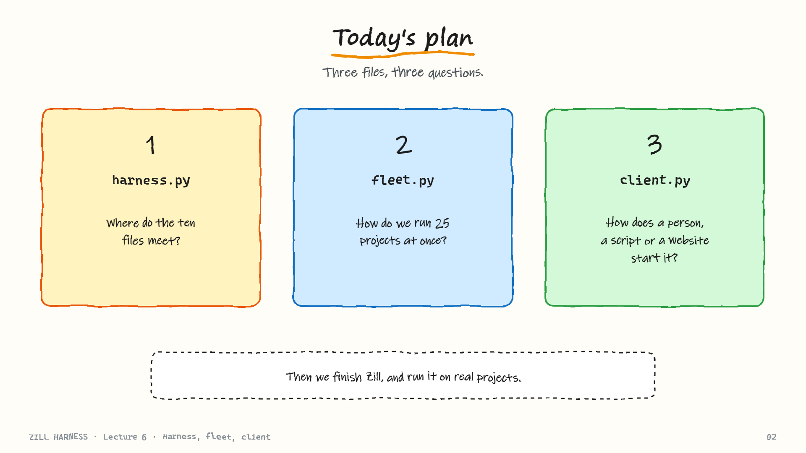
***Today's plan.** Three files, three questions.*

---

## 1. `harness.py`: one class that plugs everything together

### The class decides nothing

The whole file is one class, `Harness`. Each of the ten files plugs into it at exactly one place: the provider and the loop, the tools and the permission gate, then compaction, memory, skills, sessions and the sub-agent helper.

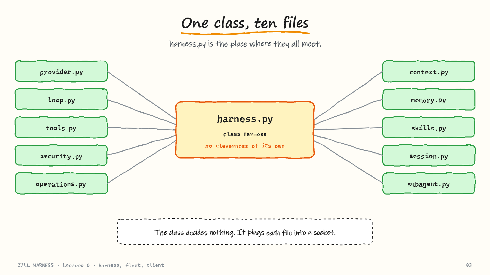
***One class, ten files.** harness.py is the place where they all meet.*

> **The Harness class has no cleverness of its own.** It has no state machine and no special rules. It takes each file already written and plugs it into the socket that file was built for.

That is also a good design signal. If your assembly class is complicated, two of your layers have usually grown into each other and you cannot swap one without breaking the other.

### A harness is an object

"Creating a harness" means creating an **instance** of the `Harness` class. The class is the recipe; a harness is one thing cooked from it.

Every instance owns its own model, tools, permission gate, system prompt, messages list and session file. Two instances share nothing, so a shop-website harness and a snake-game harness cannot see each other. A harness is not a script that runs once and disappears; it holds a whole conversation. That fact is what makes the fleet in the next section so simple.

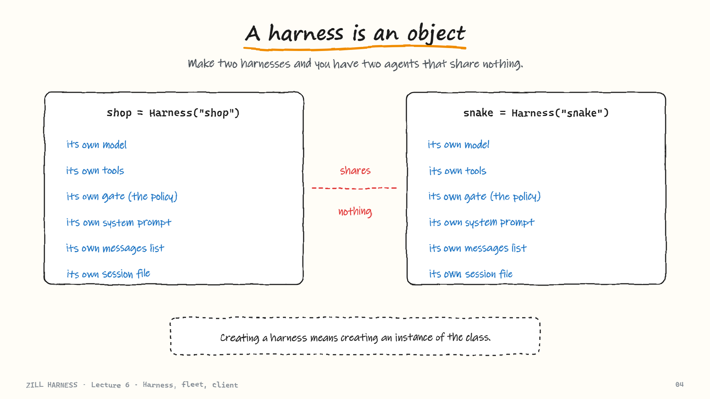
***A harness is an object.** Make two harnesses and you have two agents that share nothing.*

### What the constructor does

The constructor runs top to bottom and wires one lecture's worth of work per step:

1. Build the core tools (`core_tools`, lecture 3).
2. Build the policy, the permission gate (lecture 3).
3. Add the `remember`, `use_skill` and `spawn_agent` tools (lecture 5).
4. **Wrap every tool in the gate.** Before any tool runs, the policy looks at the call. If it says no, the tool does not run and the model receives a `BLOCKED: <reason>` message instead. There is no way to call a tool and skip the gate, because the gate is part of how the tools are built.
5. Build the system prompt from `ZILL.md` memory and the skills list.
6. `run` hands everything to the loop.

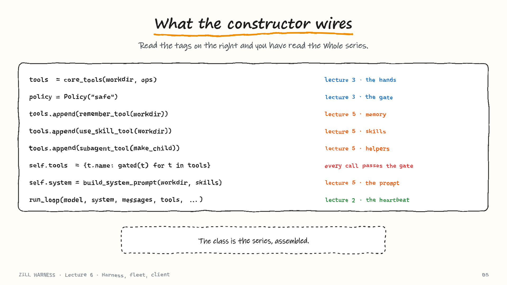
***What the constructor wires.** Read the tags on the right and you have read the whole series.*

```python
def _gated(tool, policy):
    """Wrap a tool so policy.check runs first; a reason becomes a BLOCKED result."""
    def run(**args):
        reason = policy.check({"name": tool.name, "args": args})
        return f"BLOCKED: {reason}" if reason else tool.run(**args)
    return Tool(tool.name, tool.spec, run, tool.backend)
```

Sub-agents are created with `persist=False`. If a helper wrote its own session file, the next `--resume` would wake up inside a helper's job. That bug came from lecture 5 and the build prompt guards against it explicitly.

### What `run` does

`run(task)` is five small steps, and steps 3 to 5 repeat on every lap:

1. Add the task to the messages list.
2. Write it to the session file, so it is on disk before anything else happens.
3. Compact if the conversation is over budget.
4. Ask the model.
5. For each tool the model requests, pass it through the gate, then run it.

The loop ends when the model answers in plain text with no tool calls, and that text is what `run` returns.

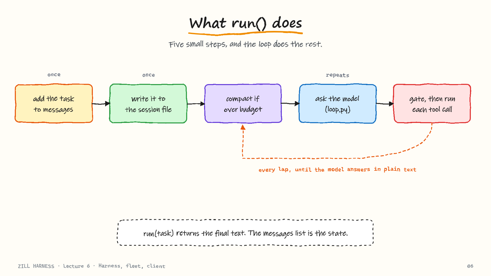
***What run() does.** Five small steps, and the loop does the rest.*

There is no separate place where "progress" is stored. **The messages list is the state.** That is why resuming a crashed session in lecture 5 was easy: there was nothing else to save.

### Where the budget check lives is a design decision

Every harness has a loop, tools, a gate and compaction. What differs is *when* the context budget is checked.

| Harness | When it checks | Consequence |
|---------|----------------|-------------|
| Hermes, Codex | Once, before the loop starts | A long task can grow past the window halfway through with nothing watching |
| Pi, **Zill** | At the top of every lap, via the `before_turn` hook | The check runs right after the previous lap's tool results arrive |

Tool results are what blow up the window: one big file or one long test log and the messages list jumps in size. Checking every lap catches that. Zill follows Pi.

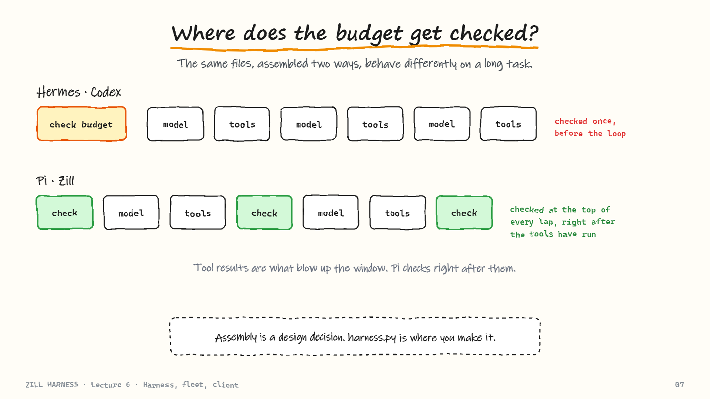
***Where does the budget get checked?.** The same files, assembled two ways, behave differently on a long task.*

Two harnesses with identical files behave differently on long tasks purely because of the wiring. Building every part correctly is not the same as building the harness; `harness.py` is where that decision is made.

### Extending it

Because the core is modular, most new features touch exactly one place:

| You want | You change |
|----------|-----------|
| Tracing of every model and tool call | `harness.py`: send events to a log file or OpenTelemetry |
| Short-term memory | `memory.py`, next to long-term memory |
| An evaluator that scores finished runs | A new `evaluator.py`; the harness does not need to know it exists |
| A new tool | Write it with the `@tool` decorator and pass it in `extra_tools`; it goes through the same gate |

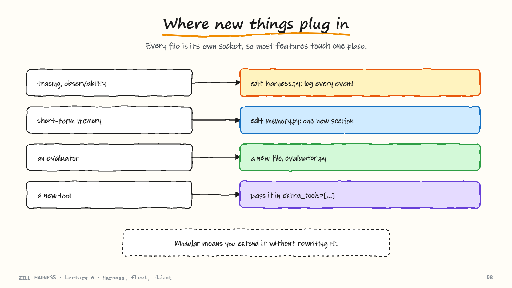
***Where new things plug in.** Every file is its own socket, so most features touch one place.*

---

## 2. `fleet.py`: many harnesses at once

You have built one harness and now want twenty-five projects. Since a harness is an object, the answer is almost too simple: **make twenty-five harnesses, each in its own folder.**

A job is three things: a name, a folder and a task. A pool of workers each takes a job, builds a fresh harness inside that job's folder, runs it, and pins the result on the board. A failure comes back as a failed result and does not stop the shift.

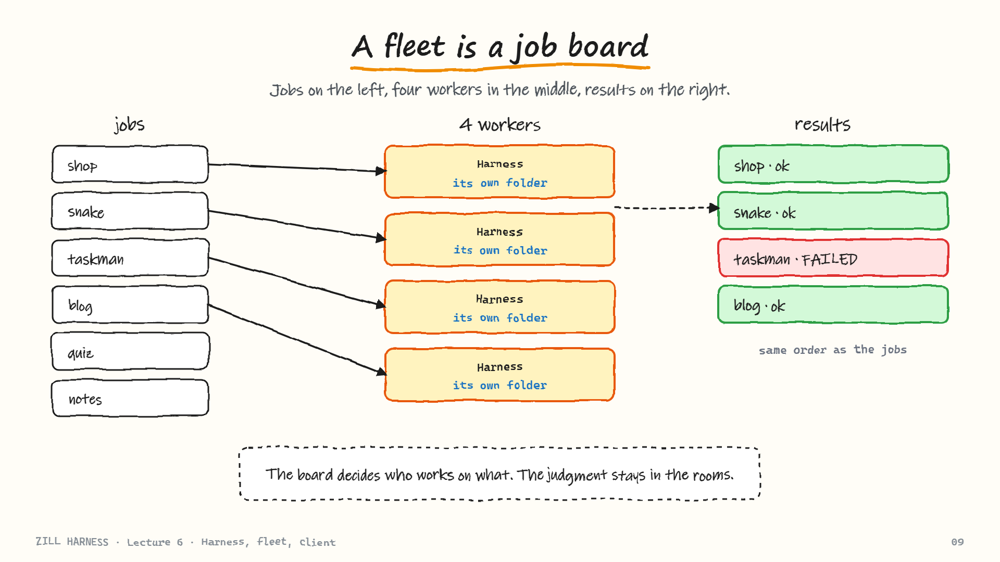
***A fleet is a job board.** Jobs on the left, four workers in the middle, results on the right.*

The board never tells a worker *how* to do the job. It only decides who works on what, and when. All judgment stays inside each harness: plain code outside, judgment inside.

### The whole file

About thirty lines, with three details carrying the design:

```python
from concurrent.futures import ThreadPoolExecutor

def run_fleet(jobs, make_harness, max_workers=4):
    """Run [{name, workdir, task}] jobs in parallel; return [{name, ok, report}] in input order."""
    def one(job):
        try:
            return {"name": job["name"], "ok": True,
                    "report": make_harness(job["workdir"]).run(job["task"])}
        except Exception as e:  # a failing job becomes a result, never an exception
            return {"name": job["name"], "ok": False, "report": f"{type(e).__name__}: {e}"}
    with ThreadPoolExecutor(max_workers=max_workers) as pool:
        return list(pool.map(one, jobs))
```

1. **Each job gets its own folder.** From lecture 3, the folder is also the jail, so one project cannot touch another project's files.
2. **A crash becomes a result.** If job 3 of 25 fails at 2 a.m. and the error escaped, the batch could stop and the other 22 jobs never run. Instead you wake up to a list with a few `ok: False` entries.
3. **Results are returned in job order.** Workers finish in whatever order they finish; `pool.map` yields in input order (unlike `as_completed`, which yields in finish order).

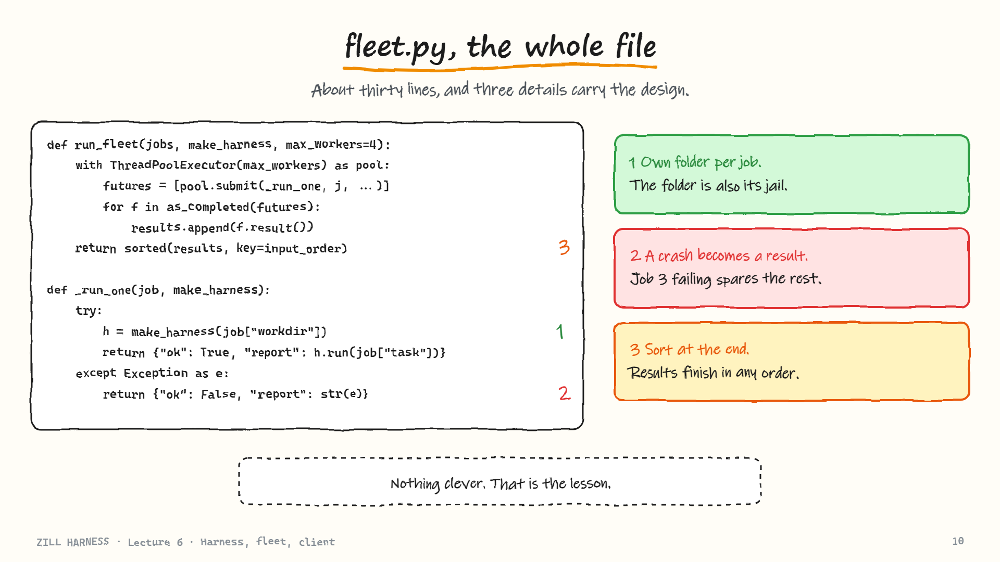
***fleet.py, the whole file.** About thirty lines, and three details carry the design.*

> Orchestration, the topic with the most marketing around it, turns out to be a thread pool.

### Fleet versus sub-agents

| | Sub-agents | Fleet | One harness, many users |
|---|-----------|-------|-------------------------|
| Shape | One parent splits its own task and hands a piece to a child | Many unrelated projects | One harness with a session ID per user |
| Shares | The parent's goal | Nothing: own harness, folder, context, memory, session | One memory and one context for everyone |
| Reports to | The parent | Nobody | n/a |
| Use when | One job split into pieces | Many separate projects | Rarely; a coffee shop and a snake game should not share memory |

**Rule of thumb:** sub-agents for one job in pieces, a fleet for many separate projects.

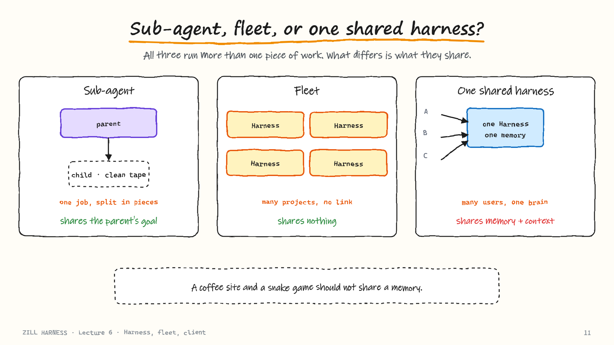
***Sub-agent, fleet, or one shared harness?.** All three run more than one piece of work. What differs is what they share.*

### Why limit the workers?

`max_workers` defaults to four. It is not a CPU setting. An agent spends most of its time waiting on the network for a model reply, so a laptop can hold many of them. The real ceilings are on the provider's side: requests per minute, tokens per minute, and your bill.

Start 25 at once and they all hit the API together, all get a rate-limit error together, all back off together and all retry at the same moment. Four at a time keeps the API comfortably under its limit. So `max_workers` is a **rate limiter**.

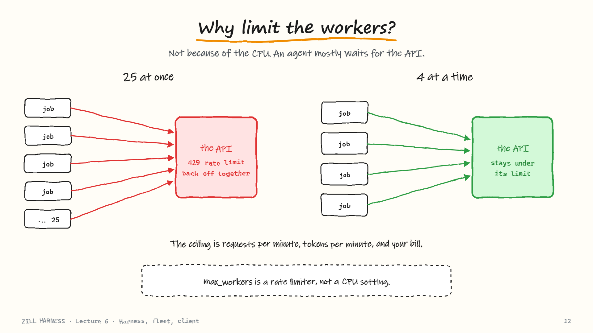
***Why limit the workers?.** Not because of the CPU. An agent mostly waits for the API.*

---

## 3. `client.py`: the front door

A class is something code can use; a tool is something a person can run. `client.py` closes that gap. It gives Zill the same two modes as other coding agents:

| Mode | Command | Behaviour |
|------|---------|-----------|
| Interactive | `python -m zill` | A prompt, a chat, and it asks before changing anything |
| Headless | `python -m zill -p "task"` | Takes the task, runs it, prints the result, exits |

Behind both doors is exactly the same `Harness`; only the defaults change.

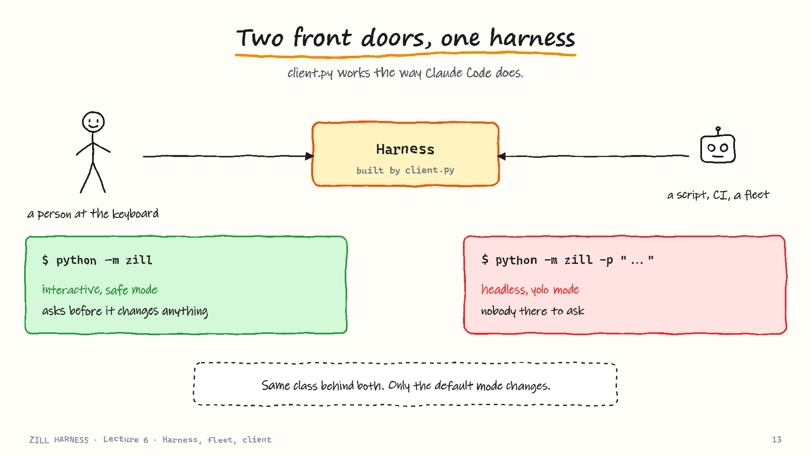
***Two front doors, one harness.** client.py works the way Claude Code does.*

### Why the defaults change

One question decides it: **was `-p` given?**

- **No:** a human is present. The mode is `safe` and the approver is a function that asks `approve write_file? [y/N]`.
- **Yes:** nobody is present. The mode becomes `yolo` and the approver is `None`. If Zill stopped to ask a question with nobody there, it would wait forever, and twenty-five jobs would all wait for a person who is asleep.

Lecture 3's policy refuses `yolo` together with bash on your own machine. So in headless mode the client also switches the backend to the **sandbox**. `yolo` is only allowed because commands run in a box.

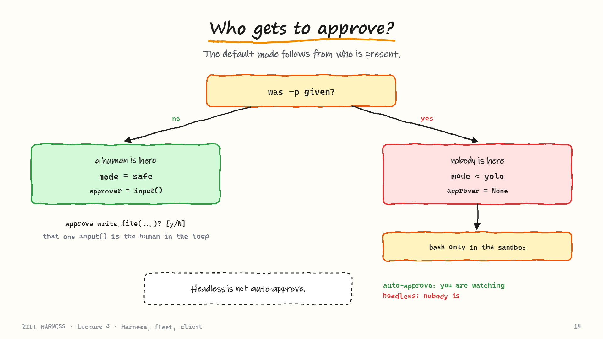
***Who gets to approve?.** The default mode follows from who is present.*

That single `input()` call, "approve, y or n", is the whole human-in-the-loop story of Zill. Every other part of supervision is the policy from lecture 3.

> **Headless is not the same as auto-approve.** Both skip the question. With auto-approve you are at your own machine and can still watch and press Ctrl+C. With headless nobody is watching: a remote job, a build-pipeline step, a fleet overnight. That is why, in headless mode, the jail and the deny rules must be tight; they are the only supervision left.

### Three ways to run an agent behind a website

A website cannot use an agent installed on your laptop. Your options:

| Option | How | Trade-off |
|--------|-----|-----------|
| 1. Run a CLI agent headless on the server | A fresh process per request, output sent back | Works and is the tested product, but starts a whole command-line tool for every request; usually the most expensive |
| 2. Use an agent SDK | The same loop and tools as a library inside your server code | A better fit than a process per request |
| 3. **Use your own harness** | Zill is already a class, so it is already an SDK | Full control; this is where building Zill pays off |

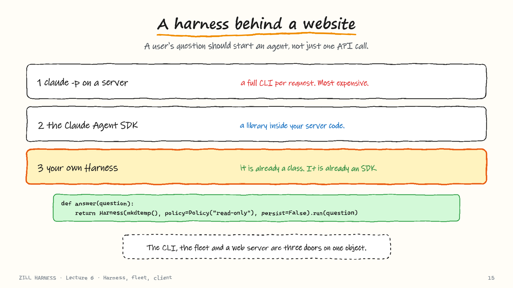
***A harness behind a website.** A user's question should start an agent, not just one API call.*

For option 3 the call is one small function: create a `Harness` in a fresh folder, run the question, return the answer. Use a **read-only** policy so the agent can look around but not change anything, and `persist=False` so it does not write a session file for every web request. That is why Zill is a class and not a script: the command line, the fleet and a web server are three different doors onto one object.

---

## 4. Build it into Zill

Four small files are added, then tested:

| File | Size target | Role |
|------|------------|------|
| [`harness.py`](../code/zill-harness/zill/harness.py) | ~70 lines | The `Harness` class |
| [`fleet.py`](../code/zill-harness/zill/fleet.py) | ~30 lines | `run_fleet` |
| [`client.py`](../code/zill-harness/zill/client.py) | ~75 lines | Command-line front door |
| [`__main__.py`](../code/zill-harness/zill/__main__.py) | 5 lines | Makes `python -m zill` work |

Tests use a fake model, so they cost nothing and need no API key. They prove that:

- safe mode with no approver returns a `BLOCKED` result and writes nothing;
- yolo mode writes the file;
- `resume()` restores the messages after a run;
- a sub-agent run leaves exactly one session file;
- `run_fleet` keeps input order and turns a failing job into `ok: False` without stopping the others;
- `client.main(["-p", ...])` returns 0.

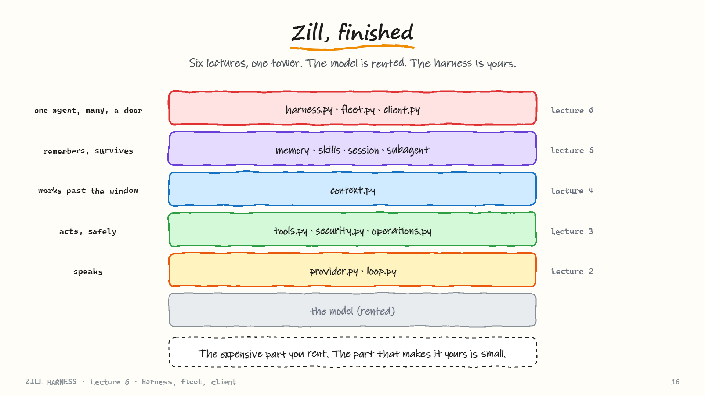
***Zill, finished.** Six lectures, one tower. The model is rented. The harness is yours.*

The full spec given to the coding agent is in [the Lecture 6 build prompt](../prompts/lecture-6-build-prompt.md). Run the tests first, then the demos, which use the real model and so use your key:

```bash
python -m unittest discover tests
python -m zill -d demo_interactive          # interactive: ask it to create hello.txt
python demos/fleet_demo.py                  # three jobs, two workers, one deliberate failure
python demos/harness_demo.py start work     # then: resume work
```

Zill is then finished.

---

## Summary

- A **harness is an object**. Two instances share nothing.
- The `Harness` class **decides nothing**; it plugs each file into its socket. The messages list is the only state.
- Where the **budget check** sits (once versus every lap) is a real design choice. Zill checks every lap, as Pi does.
- **Orchestration is plain code**: a fleet is a thread pool of independent harnesses, and the worker limit protects the API, not the CPU.
- The **client** owns only I/O. Headless mode means `yolo` on the sandbox because nobody is there to ask.
- Because Zill is a class, the CLI, a fleet and a web server are three doors on one object.
